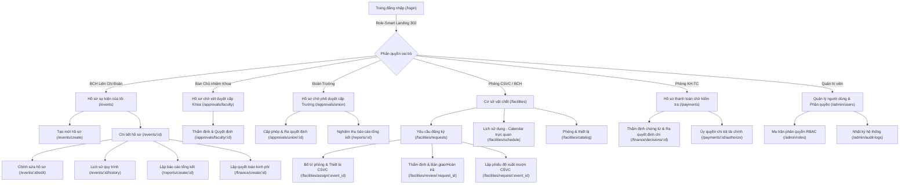
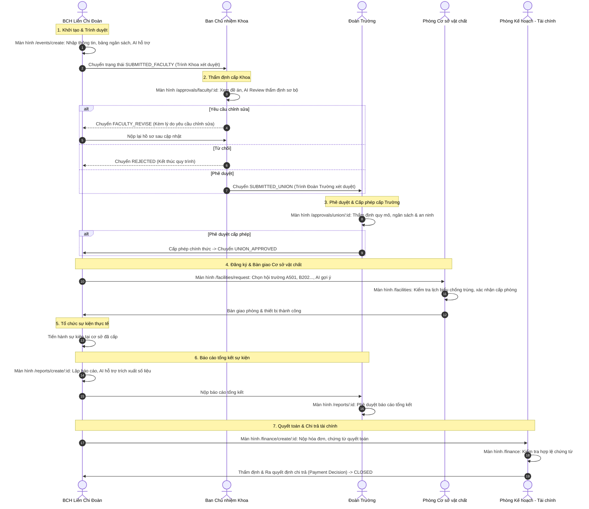

# MY DUE – BẢN ĐỒ TRANG VÀ LUỒNG GIAO DIỆN NGƯỜI DÙNG (SITEMAP & UI FLOW)

> **Dự án:** MY DUE – Hệ thống tiếp nhận, xét duyệt và cấp phép tổ chức sự kiện  
> **Đơn vị chủ quản:** Trường Đại học Kinh tế – Đại học Đà Nẵng (DUE)  
> **Căn cứ tài liệu:** Quy trình To-Be (`ToBe_Nhom3.bpmn`, `QLQT_Nhom3_to-be.bpmn`), Đề xuất tự động hóa & AI (`Nhom3.docx`), Giáo trình Chương 6 (Thiết kế GUI) và Chương 7 (Thiết kế Kiến trúc).

---

## 1. CẤU TRÚC CÂY SƠ ĐỒ TRANG (SITE MAP & ROLE-SMART DIRECT LANDING)

Hệ thống MY DUE áp dụng kiến trúc **Role-Smart Direct Landing**, loại bỏ hoàn toàn các trang "Bàn làm việc" chung tĩnh và cồng kềnh. Ngay sau khi đăng nhập thành công, mỗi vai trò nghiệp vụ được chuyển hướng trực tiếp đến không gian làm việc chuyên trách của mình, giúp người dùng bắt tay ngay vào công việc mà không tốn bất kỳ cú nhấp chuột dư thừa nào:



---

## 2. INTERFACE STRUCTURE DIAGRAM (ISD) THEO CHƯƠNG 6

Theo giáo trình **Chương 6. Thiết kế GUI**, Sơ đồ cấu trúc giao diện (ISD) mô tả mối quan hệ phân cấp giữa các màn hình, thanh điều hướng, các hộp thoại xác nhận (modal/dialog) và trạng thái hiển thị:

```
[Màn hình Đăng nhập] (Mẫu DUE E-Study: 2 cột, Logo DUE, Ảnh SanTruongDUE)
       │
       ▼ (Xác thực tài khoản thành công qua bcrypt & HTTP 302 Role Landing)
[Không gian làm việc chuyên biệt theo vai trò - Role-Smart Workspace]
  ├── [Thanh điều hướng bên trái thu gọn 240px (Sidebar)]
  │     ├── Logo DUE + Tên phân hệ "MY DUE"
  │     ├── Menu nghiệp vụ chuyên biệt theo vai trò (Chỉ hiện chức năng có thẩm quyền)
  │     └── Thông tin định danh: Đơn vị, Họ tên, Vai trò tiếng Việt
  ├── [Thanh tiêu đề trên cùng mỏng 58px (Header)]
  │     ├── Nút thu gọn / mở rộng menu (Mobile Hamburger Drawer)
  │     ├── Breadcrumb phản ánh Content Awareness ("Hồ sơ sự kiện > Chi tiết #0001")
  │     └── Nút Đăng xuất an toàn (POST method chống CSRF)
  └── [Vùng thao tác nghiệp vụ chính (Main Workspace Content Area)]
        ├── [Thanh công cụ tác vụ & Bộ lọc phân loại (Filter Tabs + Search Bar)]
        │     ├── Tab phân loại nghiệp vụ: Tất cả, Cần bổ sung, Đang thẩm định, Đã cấp phép...
        │     └── Ô tìm kiếm thời gian thực theo mã và tên sự kiện
        ├── [Bảng dữ liệu doanh nghiệp hiện đại (Enterprise Modern Data Table)]
        │     ├── Cột thông tin rõ ràng, badge trạng thái màu sắc ngữ nghĩa
        │     └── Nút thao tác nhanh trực tiếp (Primary CTA: "Xem", "Thẩm định", "Phê duyệt")
        ├── [Thanh tác vụ gắn đáy (Sticky Action Bar)] -> Nút Hành động nổi bật theo Định luật Fitts
        └── [Hộp thoại xác nhận tương tác cao (Modal Dialogs)]
              ├── Modal: Phê duyệt / Duyệt hồ sơ (Approve Modal)
              ├── Modal: Yêu cầu bổ sung chỉnh sửa (Request Changes Modal)
              ├── Modal: Từ chối hồ sơ kèm lý do (Reject Modal)
              └── Focus Trap: Khóa tab trong modal, ESC để đóng
```

---

## 3. WIREFLOW VÀ LUỒNG TƯƠNG TÁC GIỮA 5 LÀN BƠI (BPMN LANES)

Quy trình sự kiện trải qua 5 làn bơi nghiệp vụ, luồng giao diện chuyển tiếp mượt mà qua các màn hình chuyên biệt:



---

## 4. BẢNG ĐỐI CHIẾU TOÀN DIỆN BPMN TASK → ROUTE → DATABASE

Bảng ánh xạ chi tiết 33 đối tượng BPMN (Tasks, Sub-processes, Gateways, Events) sang vai trò, giao diện, Flask route, bảng cơ sở dữ liệu và Stored Procedure trong hệ thống `MY_DUE_QLSK`:

| Mã BPMN | Tên công việc / Tác vụ BPMN | Vai trò thực hiện | Màn hình giao diện | Flask Route & Method | Bảng CSDL thao tác | Stored Procedure / Trigger |
|:---|:---|:---|:---|:---|:---|:---|
| **StartEvent_1** | Khởi tạo nhu cầu tổ chức sự kiện | BCH Liên Chi Đoàn | Trang chủ Dashboard | `GET /dashboard` | `Events`, `v_EventOverview` | `usp_ListMyEvents` |
| **Task_01** | Lập kế hoạch & dự toán ngân sách | BCH Liên Chi Đoàn | Form tạo mới sự kiện | `GET, POST /events/create` | `Events`, `EventBudgetItems` | `usp_CreateEventDraft` |
| **Task_01_AI** | *AI Hỗ trợ kiểm tra đề xuất tự động* | Hệ thống (AI Assistant) | Gợi ý tự động trên Form | `POST /api/ai/suggest` | Bảng tạm bộ nhớ | Heuristic Rule Engine |
| **Gateway_01** | Kiểm tra tính đầy đủ hồ sơ | Hệ thống | Validate Form Client & Server | WTForms & Flask validate | `Events` | Schema Validation |
| **Task_02** | Trình hồ sơ lên Ban Chủ nhiệm Khoa | BCH Liên Chi Đoàn | Chi tiết sự kiện | `POST /events/<id>/submit` | `Events`, `EventTransitions` | `usp_TransitionEvent` |
| **Task_03** | Tiếp nhận hồ sơ cấp Khoa | Ban Chủ nhiệm Khoa | Hộp thư chờ duyệt Khoa | `GET /approvals/faculty` | `v_EventOverview` | Query View trực tiếp |
| **Task_04** | Thẩm định nội dung & tính phù hợp | Ban Chủ nhiệm Khoa | Thẩm định hồ sơ Khoa | `GET /approvals/faculty/<id>` | `Events`, `EventBudgetItems` | `v_EventOverview` |
| **Gateway_02** | Quyết định phê duyệt cấp Khoa | Ban Chủ nhiệm Khoa | Modal phê duyệt / chỉnh sửa | `POST /approvals/faculty/<id>/decide` | `Events`, `EventTransitions` | `usp_TransitionEvent` |
| **Task_05** | Chỉnh sửa hồ sơ theo ý kiến Khoa | BCH Liên Chi Đoàn | Form chỉnh sửa hồ sơ | `GET, POST /events/<id>/edit` | `Events`, `EventBudgetItems` | Update statement có audit |
| **Task_06** | Thông báo từ chối cấp Khoa | Hệ thống | Chi tiết sự kiện | `GET /events/<id>` | `Events`, `Notifications` | Trigger audit log |
| **Task_07** | Trình hồ sơ lên Đoàn Trường | Ban Chủ nhiệm Khoa | Tự động sau khi duyệt | `POST /approvals/faculty/<id>/decide` | `Events`, `EventTransitions` | `usp_TransitionEvent` |
| **Task_08** | Tiếp nhận hồ sơ cấp Đoàn Trường | Đoàn Trường | Hộp thư chờ duyệt Đoàn Trường | `GET /approvals/union` | `v_EventOverview` | Query View trực tiếp |
| **Task_09** | Thẩm định quy mô, an ninh & ngân sách | Đoàn Trường | Màn hình thẩm định Đoàn Trường | `GET /approvals/union/<id>` | `Events`, `EventBudgetItems` | `v_EventOverview` |
| **Gateway_03** | Quyết định phê duyệt Đoàn Trường | Đoàn Trường | Modal phê duyệt / cấp phép | `POST /approvals/union/<id>/decide` | `Events`, `EventTransitions` | `usp_TransitionEvent` |
| **Task_10** | Cấp văn bản phê duyệt tổ chức | Đoàn Trường | Chi tiết sự kiện (Status badge) | `GET /events/<id>` | `Events` | Status = `UNION_APPROVED` |
| **Task_11** | Đăng ký địa điểm & trang thiết bị | BCH Liên Chi Đoàn | Form đăng ký phòng & CSVC | `GET, POST /facilities/request` | `FacilityReservations` | Collision check query |
| **Task_11_AI** | *AI Gợi ý phòng phù hợp theo quy mô* | Hệ thống (AI Assistant) | Gợi ý trực tiếp trên Form | Client-side rule selector | `Facilities` | Rule based capacity matching |
| **Task_12** | Kiểm tra lịch biểu và trạng thái phòng | Phòng CSVC | Lịch sử dụng cơ sở vật chất | `GET /facilities` | `Facilities`, `FacilityReservations` | Query lịch biểu trùng lặp |
| **Gateway_04** | Kiểm tra xung đột địa điểm / phòng | Phòng CSVC | Cảnh báo trùng lịch | `POST /facilities/reserve` | `FacilityReservations` | `usp_ReserveFacility` |
| **Task_13** | Phê duyệt cấp phòng & bàn giao thiết bị | Phòng CSVC | Modal xác nhận cấp phòng | `POST /facilities/reservations/<id>/decide` | `FacilityReservations` | Update reservation status |
| **Task_14** | Tổ chức và điều hành sự kiện | BCH Liên Chi Đoàn | Thực tế khuôn viên DUE | Offline Event Execution | - | - |
| **Task_15** | Lập báo cáo kết quả tổ chức sự kiện | BCH Liên Chi Đoàn | Form lập báo cáo tổng kết | `GET, POST /reports/create/<id>` | `EventReports` | Insert có ràng buộc |
| **Task_15_AI** | *AI Hỗ trợ tổng hợp mẫu báo cáo* | Hệ thống (AI Assistant) | Nút tạo mẫu thông minh | `POST /api/ai/report-draft` | Bảng tạm bộ nhớ | Template generation engine |
| **Task_16** | Nộp báo cáo tổng kết cho Đoàn Trường | BCH Liên Chi Đoàn | Chi tiết báo cáo | `POST /reports/<id>/submit` | `EventReports` | Update Status `SUBMITTED` |
| **Task_17** | Xem xét và nghiệm thu báo cáo sự kiện | Đoàn Trường | Màn hình duyệt báo cáo | `POST /reports/<id>/approve` | `EventReports` | Update Status `APPROVED` |
| **Task_18** | Tập hợp hóa đơn và chứng từ chi phí | BCH Liên Chi Đoàn | Form đề nghị quyết toán | `GET, POST /finance/create/<id>` | `PaymentDecisions` | Insert quyết toán chi |
| **Task_19** | Thẩm định hồ sơ thanh quyết toán | Phòng KH-TC | Danh sách thẩm định tài chính | `GET /finance` | `PaymentDecisions`, `v_EventOverview` | Query chứng từ quyết toán |
| **Gateway_05** | Kiểm tra tính hợp lệ chứng từ | Phòng KH-TC | Quyết định thẩm định tài chính | `POST /finance/decisions/<id>/decide` | `PaymentDecisions` | Validate ngân sách thực tế |
| **Task_20** | Cấp ủy quyền chi trả / Giải ngân | Ban Giám hiệu / KHTC | Phê duyệt ủy quyền chi trả | `POST /payments/<id>/authorize` | `PaymentDecisions`, `Events` | `usp_TransitionEvent` |
| **EndEvent_1** | Sự kiện hoàn tất và lưu trữ hồ sơ | Tất cả vai trò | Chi tiết sự kiện (Hoàn tất) | `GET /events/<id>` | `Events` | Status = `CLOSED` |

---
*Tài liệu được sinh tự động và chuẩn hóa bởi Antigravity Engine – Kiến trúc hệ thống MY DUE.*
