# BẢN ĐẶC TẢ KỊCH BẢN TƯƠNG TÁC FIGMA PROTOTYPE (PROTOTYPE CONNECTIONS SPECIFICATION)

> **Dự án**: Cổng thông tin Quản lý Quy trình Xét duyệt và Tổ chức Sự kiện MY DUE  
> **Căn cứ nghiệp vụ**: `ToBe_Nhom3.bpmn`, `Nhom3.docx`, `docs/ui-screen-inventory.md`, `docs/bpmn-ui-mapping.md`  
> **Phạm vi kịch bản**: 37 màn hình Desktop (1440×900 px) & 37 màn hình Mobile Web (390×844 px)  
> **Mục tiêu**: Định nghĩa 100% dây nối tương tác Prototype trong Figma Design, mô phỏng mượt mà Luồng chính (Happy Path) và toàn bộ 6 Cổng rẽ nhánh XOR nghiệp vụ.

---

## 1. NGUYÊN LÝ THIẾT LẬP TƯƠNG TÁC TRONG FIGMA

Mỗi liên kết tương tác (Interaction Wire) trong Figma được cấu hình với các thông số tiêu chuẩn sau:

1. **Trigger (Hành động kích hoạt)**:
   - `On Click` / `On Tap`: Áp dụng cho nút bấm, hàng trong bảng, icon chuyển tab, liên kết breadcrumb.
   - `After Delay` (`800ms - 1500ms`): Áp dụng cho các bước mô phỏng **Service Task** tự động hóa trong BPMN (ví dụ: `CheckFields`, `AIReview`, `ForwardDoan`, `FacilityForm`, `CheckSchedule`, `AISuggest`, `AIReport`, `AutoReport`, `AutoForwardPay`).
   - `While Hovering`: Đổi biến thể (State Variant) cho các Button và Menu Item.

2. **Action & Destination (Hành động và Đích đến)**:
   - `Navigate To`: Chuyển trang trực tiếp sang Frame màn hình đích.
   - `Open Overlay`: Mở Modal hộp thoại (Duyệt, Yêu cầu sửa, Từ chối) hoặc Drawer Menu trên Mobile. Thiết lập: Overlay Position = `Center` (Desktop) hoặc `Bottom center` (Mobile), Cờ chọn: `Close when clicking outside`, Màu phủ: `#0F172A` với Opacity `45%`.
   - `Close Overlay`: Đóng hộp thoại khi bấm nút "Hủy bỏ" hoặc icon "Đóng".

3. **Animation & Easing**:
   - Chuyển trang tiêu chuẩn: `Instant` hoặc `Dissolve` (`150ms`, `ease-out`).
   - Chuyển tiếp luồng AI hoặc Service Task: `Smart Animate` (`300ms`, `ease-in-and-out`).
   - Drawer Menu / Bottom Sheet: `Slide In` (`250ms`, `ease-out`).

---

## 2. MA TRẬN KỊCH BẢN TƯƠNG TÁC 37 MÀN HÌNH (PROTOTYPE CONNECTIONS MATRIX)

Bảng ma trận dưới đây quy định chi tiết luồng bấm từ Màn hình 00 đến Màn hình 36:

| ID Màn hình Nguồn | Tên màn hình nguồn | Thành phần tương tác (UI Element / Button) | Loại Trigger | Hành động Figma | ID Màn hình Đích | Tên màn hình đích & Trạng thái chuyển đổi |
|:---:|:---|:---|:---:|:---:|:---:|:---|
| **00** | Tổng quan quy trình | Nút `+ Tạo hồ sơ mới` | On Click | Navigate To | **03** | Lập kế hoạch và hồ sơ tổ chức (Bắt đầu Start -> Prepare) |
| **00** | Tổng quan quy trình | Hàng sự kiện gần nhất (`HS-2026-0042`) | On Click | Navigate To | **02** | Chi tiết hồ sơ và tiến độ (Xem Timeline tracking) |
| **00** | Tổng quan quy trình | Menu Sidebar `Hồ sơ sự kiện` | On Click | Navigate To | **01** | Danh sách hồ sơ sự kiện |
| **01** | Danh sách hồ sơ sự kiện | Nút `Xem chi tiết` trên hàng bảng | On Click | Navigate To | **02** | Chi tiết hồ sơ và tiến độ |
| **01** | Danh sách hồ sơ sự kiện | Nút `Lập hồ sơ mới` | On Click | Navigate To | **03** | Lập kế hoạch và hồ sơ tổ chức |
| **02** | Chi tiết hồ sơ và tiến độ | Nút `Tiếp tục chỉnh sửa` (nếu đang ở BCH) | On Click | Navigate To | **03** | Lập kế hoạch hoặc màn hình tương ứng với chặng hiện tại |
| **02** | Chi tiết hồ sơ và tiến độ | Liên kết Breadcrumb `Tổng quan` | On Click | Navigate To | **00** | Quay về Tổng quan quy trình |
| **03** | Lập kế hoạch và hồ sơ | Nút `Tiếp tục: Lập dự trù kinh phí` | On Click | Navigate To | **04** | Lập dự trù kinh phí (Validate CheckFields thành công) |
| **03** | Lập kế hoạch và hồ sơ | Để trống trường bắt buộc + bấm Tiếp tục | On Click | Change To Variant | **03** | Variant Error: Hiển thị viền đỏ và text lỗi inline |
| **04** | Lập dự trù kinh phí | Nút `Kích hoạt AI rà soát hồ sơ` | On Click | Navigate To | **05** | Rà soát hồ sơ bằng AI (Kích hoạt Task AIReview) |
| **04** | Lập dự trù kinh phí | Nút `Quay lại: Thông tin sự kiện` | On Click | Navigate To | **03** | Lập kế hoạch và hồ sơ tổ chức |
| **05** | Rà soát hồ sơ bằng AI | Nút `Áp dụng gợi ý & Tiếp tục` | On Click | Navigate To | **06** | Kiểm chứng và hoàn thiện hồ sơ (Chuyển tiếp sau AI) |
| **05** | Rà soát hồ sơ bằng AI | Nút `Giữ nguyên & Tiếp tục` | On Click | Navigate To | **06** | Kiểm chứng và hoàn thiện hồ sơ |
| **06** | Kiểm chứng và hoàn thiện | Tích đủ 4 tiêu chí cam kết + Nút `Nộp hồ sơ` | On Click | Navigate To | **07** | Nộp hồ sơ cho BCN Khoa (Kích hoạt SubmitKhoa) |
| **07** | Nộp hồ sơ cho BCN Khoa | Tự động sau 1.2s (hoặc nút `Chuyển vai trò`) | After Delay / Click | Navigate To | **08** | Hồ sơ chờ thẩm định cấp khoa (Đổi vai trò sang BCN Khoa) |
| **08** | Hồ sơ chờ thẩm định Khoa | Nút `Thẩm định ngay` trên hồ sơ | On Click | Navigate To | **09** | Thẩm định hồ sơ cấp khoa (ReviewKhoa) |
| **09** | Thẩm định hồ sơ cấp khoa | **[CỔNG GKHOA - DUYỆT]** Nút `Phê duyệt` | On Click | Navigate To | **11** | Khoa ký xác nhận hồ sơ (SignKhoa) |
| **09** | Thẩm định hồ sơ cấp khoa | **[CỔNG GKHOA - SỬA]** Nút `Yêu cầu sửa` | On Click | Open Overlay | - | Modal nhập góp ý của Khoa |
| - | Modal góp ý Khoa | Nút `Gửi yêu cầu chỉnh sửa` | On Click | Navigate To | **10** | Chỉnh sửa theo góp ý Khoa (Đổi vai trò về BCH) |
| **09** | Thẩm định hồ sơ cấp khoa | **[CỔNG GKHOA - TỪ CHỐI]** Nút `Từ chối`| On Click | Open Overlay | - | Modal xác nhận không chấp thuận |
| - | Modal từ chối Khoa | Nút `Xác nhận từ chối hồ sơ` | On Click | Navigate To | **02** | Trạng thái hồ sơ chuyển sang Dừng/Từ chối (`RejectKhoa`) |
| **10** | Chỉnh sửa theo góp ý Khoa | Nút `Lưu & Chuyển kiểm chứng` | On Click | Navigate To | **06** | Quay lại Kiểm chứng hồ sơ (`Gateway_0q4ts0h` -> `BCHConfirm`) |
| **11** | Khoa ký xác nhận hồ sơ | Nút `Ký số & Chuyển Đoàn trường` | On Click | Navigate To | **12** | Chuyển hồ sơ đến Đoàn trường (Kích hoạt ForwardDoan) |
| **12** | Chuyển hồ sơ Đoàn trường | Tự động sau 1.2s (hoặc nút `Xem hòm thư`) | After Delay / Click | Navigate To | **13** | Hồ sơ chờ thẩm định Đoàn trường (Đổi vai trò Đoàn Trường) |
| **13** | Hồ sơ chờ thẩm định Đoàn | Nút `Bắt đầu thẩm định` trên hồ sơ | On Click | Navigate To | **14** | Thẩm định hồ sơ tại Đoàn trường (ReviewDoan) |
| **14** | Thẩm định Đoàn trường | **[CỔNG GDOAN - DUYỆT]** Nút `Ký duyệt & Cấp phép` | On Click | Navigate To | **16** | Ký duyệt và đóng dấu kế hoạch (ApproveDoan) |
| **14** | Thẩm định Đoàn trường | **[CỔNG GDOAN - SỬA]** Nút `Yêu cầu chỉnh sửa` | On Click | Open Overlay | - | Modal nhập chỉ đạo chỉnh sửa của Đoàn |
| - | Modal chỉnh sửa Đoàn | Nút `Chuyển yêu cầu sửa đổi` | On Click | Navigate To | **15** | Chỉnh sửa theo góp ý Đoàn trường (Đổi vai trò BCH) |
| **14** | Thẩm định Đoàn trường | **[CỔNG GDOAN - TỪ CHỐI]** Nút `Từ chối` | On Click | Open Overlay | - | Modal từ chối cấp phép |
| - | Modal từ chối Đoàn | Nút `Xác nhận không cấp phép` | On Click | Navigate To | **02** | Trạng thái hồ sơ chuyển sang Bị từ chối (`RejectDoan`) |
| **15** | Chỉnh sửa theo góp ý Đoàn | Nút `Hoàn tất & Kiểm chứng lại` | On Click | Navigate To | **06** | Quay lại Kiểm chứng hồ sơ (`Gateway_0q4ts0h` -> `BCHConfirm`) |
| **16** | Ký duyệt đóng dấu kế hoạch | Nút `Đóng dấu mộc số & Kích hoạt CSVC` | On Click | Navigate To | **17** | Tạo đơn mượn CSVC (Tự động hóa FacilityForm) |
| **17** | Tạo đơn mượn CSVC | Nút `Đối chiếu lịch & thiết bị` | On Click | Navigate To | **18** | Đối chiếu lịch và thiết bị (CheckSchedule) |
| **18** | Đối chiếu lịch và thiết bị | Nút `Nhận đề xuất AI bố trí` | On Click | Navigate To | **19** | AI gợi ý bố trí phòng thiết bị (AISuggest) |
| **19** | AI gợi ý bố trí phòng CSVC| Nút `Chuyển chuyên viên CSVC thẩm định`| On Click | Navigate To | **20** | Xác minh và quyết định CSVC (FacilityUser) |
| **20** | Xác minh quyết định CSVC | **[CỔNG GFACILITY - CÓ]** Nút `Xác nhận cấp` | On Click | Navigate To | **22** | Xác nhận đặt phòng và thiết bị (ApproveFacility) |
| **20** | Xác minh quyết định CSVC | **[CỔNG GFACILITY - CHƯA]** Nút `Báo trùng lịch` | On Click | Navigate To | **21** | Điều chỉnh lịch hoặc thiết bị (Đổi vai trò BCH) |
| **21** | Điều chỉnh lịch thiết bị | Chọn Hội trường H còn trống + Nút `Cập nhật`| On Click | Navigate To | **17** | Quay lại Tạo đơn mượn CSVC cập nhật lại lịch |
| **22** | Xác nhận đặt phòng CSVC | Nút `Xuất phiếu cấp phòng & Bàn giao` | On Click | Navigate To | **23** | Chuẩn bị và tổ chức sự kiện (PrepareEvent) |
| **23** | Chuẩn bị và tổ chức sự kiện | Tích hoàn thành checklist + Nút `Hoàn trả CSVC` | On Click | Navigate To | **24** | Hoàn trả cơ sở vật chất (ReturnFacility) |
| **24** | Hoàn trả cơ sở vật chất | Nút `Gửi yêu cầu nghiệm thu hoàn trả` | On Click | Navigate To | **25** | Kiểm tra tình trạng hoàn trả (VerifyReturn - CSVC) |
| **25** | Kiểm tra tình trạng hoàn trả | **[CỔNG GREPORT - CÓ]** Nút `Yêu cầu báo cáo` | On Click | Navigate To | **26** | AI tạo bản nháp báo cáo (AIReport - BCH) |
| **25** | Kiểm tra tình trạng hoàn trả | **[CỔNG GREPORT - KHÔNG]** Nút `Miễn báo cáo` | On Click | Navigate To | **29** | Điểm hội tụ `MergeReport` -> Lập hồ sơ chứng từ thanh toán |
| **26** | AI tạo bản nháp báo cáo | Nút `Xem xét & Chỉnh sửa dự thảo` | On Click | Navigate To | **27** | Kiểm tra và xác nhận báo cáo (ReviewReport) |
| **27** | Kiểm tra và xác nhận báo cáo| Nút `Ký xác nhận & Gửi báo cáo` | On Click | Navigate To | **28** | Gửi báo cáo đến Đoàn trường (AutoReport) |
| **28** | Gửi báo cáo đến Đoàn trường | Tự động sau 1.2s (hoặc nút `Chuyển thanh toán`) | After Delay / Click | Navigate To | **29** | Lập và rà soát hồ sơ chứng từ (PayPackage) |
| **29** | Lập chứng từ thanh toán | Tải đủ hóa đơn VAT + Nút `Gửi KHTC thẩm định` | On Click | Navigate To | **30** | Kiểm tra chứng từ thanh toán (CheckPay - KHTC) |
| **30** | Kiểm tra chứng từ thanh toán| **[CỔNG GPAY - ĐỦ]** Nút `Hồ sơ hợp lệ` | On Click | Navigate To | **32** | Trình hồ sơ duyệt thanh toán (SubmitApproval) |
| **30** | Kiểm tra chứng từ thanh toán| **[CỔNG GPAY - THIẾU]** Nút `Yêu cầu bổ sung`| On Click | Navigate To | **31** | Bổ sung hồ sơ thanh toán (FixPay - BCH) |
| **31** | Bổ sung hồ sơ thanh toán | Tải hóa đơn thay thế + Nút `Nộp lại chứng từ` | On Click | Navigate To | **30** | Quay lại Kiểm tra chứng từ thanh toán tại KHTC |
| **32** | Trình hồ sơ duyệt thanh toán| Nút `Ký trình Lãnh đạo phê duyệt` | On Click | Navigate To | **33** | Phê duyệt thanh toán (ApprovePayment - BGH/KHTC) |
| **33** | Phê duyệt thanh toán | **[CỔNG GAPPROVAL - CÓ]** Nút `Phê duyệt chi` | On Click | Navigate To | **35** | Thực hiện thanh toán (PerformPay) |
| **33** | Phê duyệt thanh toán | **[CỔNG GAPPROVAL - KHÔNG]** Nút `Không duyệt`| On Click | Navigate To | **34** | Thông báo không thanh toán (RefusePay) |
| **34** | Thông báo không thanh toán | Nút `Gửi thông báo & Đóng hồ sơ` | On Click | Navigate To | **36** | Xác nhận và lưu trữ hồ sơ (Close & End Event) |
| **35** | Thực hiện thanh toán | Nhập mã giao dịch + Nút `Xác nhận giải ngân` | On Click | Navigate To | **36** | Xác nhận và lưu trữ hồ sơ (Close & End Event) |
| **36** | Xác nhận và lưu trữ hồ sơ | Nút `Xuất hồ sơ điện tử (PDF/ZIP)` / `Về trang chủ` | On Click | Navigate To | **00** | Quay về Tổng quan quy trình (Vòng đời hoàn tất 100%) |

---

## 3. QUY CHUẨN CHI TIẾT 6 CỔNG RẼ NHÁNH XOR (EXCLUSIVE GATEWAYS)

Toàn bộ 6 cổng Exclusive Gateway trong mô hình To-Be đều được mô phỏng với đầy đủ các nhánh nghiệp vụ rẽ nhánh, không bỏ sót bất kỳ tình huống nào:

```mermaid
flowchart TD
    subgraph G1["Cổng 1: GKhoa (BCN Khoa)"]
        K09["Màn hình 09: ReviewKhoa"] -->|Duyệt Flow_010| K11["Màn hình 11: SignKhoa"]
        K09 -->|Sửa Flow_007| K10["Màn hình 10: FixKhoa"]
        K09 -->|Từ chối Flow_009| KEnd["Dừng quy trình: RejectKhoa"]
        K10 -->|Hội tụ Gateway_0q4ts0h| K06["Màn hình 06: BCHConfirm"]
    end

    subgraph G2["Cổng 2: GDoan (Đoàn Trường)"]
        D14["Màn hình 14: ReviewDoan"] -->|Duyệt Flow_014| D16["Màn hình 16: ApproveDoan"]
        D14 -->|Sửa Flow_015| D15["Màn hình 15: FixDoan"]
        D14 -->|Từ chối Flow_017| DEnd["Dừng quy trình: RejectDoan"]
        D15 -->|Hội tụ Gateway_0q4ts0h| D06["Màn hình 06: BCHConfirm"]
    end

    subgraph G3["Cổng 3: GFacility (Phòng CSVC)"]
        F20["Màn hình 20: FacilityUser"] -->|Có Flow_023| F22["Màn hình 22: ApproveFacility"]
        F20 -->|Chưa Flow_024| F21["Màn hình 21: AdjustFacility"]
        F21 -->|Cập nhật lại| F17["Màn hình 17: FacilityForm"]
    end

    subgraph G4["Cổng 4: GReport (Yêu cầu Báo cáo?)"]
        R25["Màn hình 25: VerifyReturn"] -->|Có Flow_031| R26["Màn hình 26: AIReport"]
        R25 -->|Không Flow_030| R29["Hội tụ MergeReport -> Màn hình 29"]
        R26 --> R27["Màn 27"] --> R28["Màn 28"] --> R29
    end

    subgraph G5["Cổng 5: GPay (Hồ sơ chứng từ KHTC)"]
        P30["Màn hình 30: CheckPay"] -->|Đủ Flow_039| P32["Màn hình 32: SubmitApproval"]
        P30 -->|Thiếu Flow_040| P31["Màn hình 31: FixPay"]
        P31 -->|Nộp lại| P30
    end

    subgraph G6["Cổng 6: GApproval (Phê duyệt chi thanh toán)"]
        A33["Màn hình 33: ApprovePayment"] -->|Có Flow_046| A35["Màn hình 35: PerformPay"]
        A33 -->|Không Flow_044| A34["Màn hình 34: RefusePay"]
        A35 --> A36["Màn hình 36: Close"]
        A34 --> A36
    end
```

### 3.1. Cổng `GKhoa` (Kết quả thẩm định của Ban Chủ nhiệm Khoa)
- **Màn hình kích hoạt**: Màn hình 09 (`ReviewKhoa`).
- **3 Nhánh rẽ tương tác**:
  1. **Nhánh Duyệt (`Flow_010`)**: Bấm nút xanh lá `Phê duyệt kế hoạch` -> Điều hướng sang Màn hình 11 (`SignKhoa`) để đại diện BCN Khoa ký số điện tử.
  2. **Nhánh Sửa (`Flow_007`)**: Bấm nút cam `Yêu cầu chỉnh sửa` -> Mở Modal nhập ý kiến chỉ đạo -> Bấm `Gửi yêu cầu` -> Điều hướng sang Màn hình 10 (`FixKhoa`) cho BCH Liên Chi Đoàn. BCH cập nhật nội dung -> Bấm `Lưu & Tiếp tục` -> Chuyển luồng qua cổng hội tụ `Gateway_0q4ts0h` về Màn hình 06 (`BCHConfirm`) để ký xác nhận và nộp lại qua Màn hình 07.
  3. **Nhánh Từ chối (`Flow_009`)**: Bấm nút đỏ `Không chấp thuận` -> Mở Modal cảnh báo từ chối -> Nhập lý do (VD: *"Kế hoạch không phù hợp định hướng nghiên cứu khoa học của Khoa năm 2026"*) -> Bấm `Xác nhận từ chối` -> Điều hướng sang Trạng thái kết thúc `RejectKhoa`. Ticket ID chuyển sang trạng thái "Bị từ chối bởi BCN Khoa", đóng luồng.

### 3.2. Cổng `GDoan` (Kết quả thẩm định của Đoàn Trường)
- **Màn hình kích hoạt**: Màn hình 14 (`ReviewDoan`).
- **3 Nhánh rẽ tương tác**:
  1. **Nhánh Duyệt (`Flow_014`)**: Bấm nút xanh lá `Ký duyệt & Cấp phép` -> Điều hướng sang Màn hình 16 (`ApproveDoan`) -> Bấm `Đóng dấu mộc số` -> Kích hoạt Service Task Màn hình 17 (`FacilityForm`).
  2. **Nhánh Sửa (`Flow_015`)**: Bấm nút cam `Yêu cầu chỉnh sửa` -> Mở Modal nhập lý do (VD: *"Cần bổ sung phương án y tế cấp cứu và bảo đảm an ninh trật tự"*) -> Chuyển sang Màn hình 15 (`FixDoan`) cho BCH -> BCH hoàn thiện -> Bấm `Lưu thay đổi` -> Luồng quay về Màn hình 06 (`BCHConfirm`) qua `Gateway_0q4ts0h` để nộp lại.
  3. **Nhánh Từ chối (`Flow_017`)**: Bấm nút đỏ `Từ chối phê duyệt` -> Chuyển sang Trạng thái kết thúc `RejectDoan` (Thông báo không cho phép tổ chức, lưu vết lý do, dừng quy trình).

### 3.3. Cổng `GFacility` (Khả năng đáp ứng của Phòng Cơ sở vật chất)
- **Màn hình kích hoạt**: Màn hình 20 (`FacilityUser`).
- **2 Nhánh rẽ tương tác**:
  1. **Nhánh Có (`Flow_023`)**: Chuyên viên CSVC xác nhận hội trường và thiết bị đảm bảo 100% -> Bấm nút xanh lá `Xác nhận cấp địa điểm & thiết bị` -> Điều hướng sang Màn hình 22 (`ApproveFacility`) -> Xuất Phiếu đặt phòng điện tử và khóa lịch trên Booking Calendar.
  2. **Nhánh Chưa (`Flow_024`)**: Chuyên viên phát hiện Hội trường A bị trùng lịch bảo trì âm thanh -> Bấm nút cam `Báo trùng lịch / Chưa đáp ứng` -> Điều hướng sang Màn hình 21 (`AdjustFacility`) cho BCH Liên Chi Đoàn. Giao diện hiển thị gợi ý Hội trường H còn trống -> BCH bấm chọn `Đổi sang Hội trường H` -> Bấm `Cập nhật yêu cầu` -> Tự động quay lại Màn hình 17 (`FacilityForm`) và 18 (`CheckSchedule`) để kiểm tra lại lịch trống.

### 3.4. Cổng `GReport` (Yêu cầu nộp báo cáo tổng kết)
- **Màn hình kích hoạt**: Màn hình 25 (`VerifyReturn`).
- **2 Nhánh rẽ tương tác**:
  1. **Nhánh Có (`Flow_031`)**: Sự kiện quy mô lớn (Hội thảo cấp Trường, Hackathon) theo quy chế bắt buộc có báo cáo -> Bấm `Nghiệm thu & Yêu cầu nộp báo cáo` -> Kích hoạt Service Task Màn hình 26 (`AIReport`) tự động tạo bản nháp -> Chuyển Màn hình 27 (`ReviewReport`) cho BCH ký xác nhận -> Tự động gửi Đoàn trường tại Màn hình 28 (`AutoReport`) -> Chuyển qua điểm hội tụ `MergeReport` đến Màn hình 29 (`PayPackage`).
  2. **Nhánh Không (`Flow_030`)**: Sự kiện sinh hoạt định kỳ nhỏ không yêu cầu báo cáo tổng kết -> Bấm `Nghiệm thu & Chuyển quyết toán` -> Bỏ qua Màn hình 26-28, đi thẳng từ `MergeReport` sang Màn hình 29 (`PayPackage`) để quyết toán kinh phí.

### 3.5. Cổng `GPay` (Kiểm tra hồ sơ chứng từ tại Phòng KHTC)
- **Màn hình kích hoạt**: Màn hình 30 (`CheckPay`).
- **2 Nhánh rẽ tương tác**:
  1. **Nhánh Đủ (`Flow_039`)**: Chuyên viên KHTC kiểm tra bảng kê và hóa đơn VAT điện tử hợp lệ 100% -> Bấm nút xanh lá `Chứng từ hợp lệ & Lập tờ trình` -> Điều hướng sang Màn hình 32 (`SubmitApproval`).
  2. **Nhánh Thiếu (`Flow_040`)**: Phát hiện hóa đơn in ấn thiếu mã số thuế Trường ĐHKT -> Bấm nút cam `Yêu cầu bổ sung chứng từ` -> Điều hướng sang Màn hình 31 (`FixPay`) cho BCH -> BCH tải lên file hóa đơn VAT điều chỉnh -> Bấm `Nộp lại chứng từ` -> Hệ thống tự động gửi lại hòm thư KHTC, quay về Màn hình 30 (`CheckPay`).

### 3.6. Cổng `GApproval` (Phê duyệt chi thanh toán tối cao)
- **Màn hình kích hoạt**: Màn hình 33 (`ApprovePayment`).
- **2 Nhánh rẽ tương tác**:
  1. **Nhánh Có (`Flow_046`)**: Lãnh đạo Trường / Chủ tài khoản bấm nút xanh lá `Phê duyệt chi thanh toán` -> Điều hướng sang Màn hình 35 (`PerformPay`) -> KHTC xuất ủy nhiệm chi điện tử giải ngân vào tài khoản Liên Chi Đoàn -> Điều hướng sang Màn hình 36 (`Close & End`) hoàn tất quy trình thành công.
  2. **Nhánh Không (`Flow_044`)**: Chi phí vượt khung định mức không có văn bản giải trình được chấp thuận -> Lãnh đạo bấm nút đỏ `Không phê duyệt chi` -> Điều hướng sang Màn hình 34 (`RefusePay`) -> Ban hành Thông báo không thanh toán số hóa -> Chuyển sang Màn hình 36 (`Close & End`) lưu trữ hồ sơ với trạng thái "Đã từ chối thanh toán".

---

## 4. KỊCH BẢN ĐIỀU HƯỚNG TRÊN MOBILE WEB (390 × 844 PX)

1. **Drawer Menu Navigation**:
   - Chạm vào Icon Hamburger trên Header di động -> Kích hoạt `Open Overlay` gọi Frame `Drawer_Menu_Mobile` trượt từ cạnh trái sang (`Direction: Left`, `Slide In`, `250ms`).
   - Chọn phân hệ nghiệp vụ -> `Navigate To` màn hình tương ứng và tự động đóng Drawer.

2. **Bottom Sheet cho các thao tác Duyệt / Sửa / Từ chối**:
   - Khi bấm các nút rẽ nhánh trên Mobile, hộp thoại không hiện giữa màn hình mà trượt lên từ đáy (`Bottom Sheet` modal, `Slide In from Bottom`, `300ms`).
   - Có thanh tay cầm (Drag Handle) ở đỉnh sheet để vuốt xuống đóng nhanh.

3. **Bottom Sticky Action Bar**:
   - Các nút hành động chính (Tiếp tục, Nộp hồ sơ, Phê duyệt, Ký số) được neo cố định ở đáy màn hình di động (`Fixed at bottom`, chiều cao `72px` tính cả safe area), giúp thao tác dễ dàng bằng một tay.
